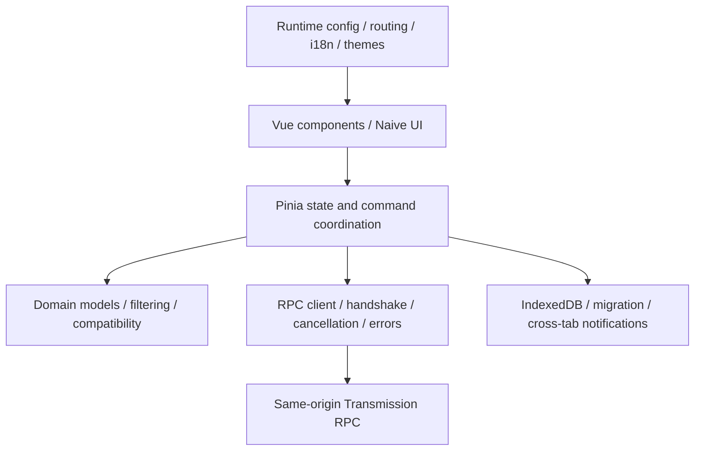

# Transmission Web UI


[简体中文](README.md) | **English**

A modern Transmission web interface for NAS, Docker, and Linux. Rebuilt with Vue 3 and TypeScript, it provides torrent management, file selection, Tracker editing, existing-data matching, multiple languages, and customizable layouts and themes through your existing Transmission RPC service.

Releases contain complete static HTML, JavaScript, and CSS. Deployment requires no Node.js, npm, Python, database, or external CDN. Keep your Transmission service and download data; use the single-file offline installer for supported Synology deployments.

[Download releases](https://github.com/nimbusking/transmission-web-ui/releases) · [Report an issue](https://github.com/nimbusking/transmission-web-ui/issues) · [Project blog](https://nimbusk.cc)

Version 2.1.0 adds local browser diagnostics, manual JSON export, and scoped offline failure replay. See the [collection, storage, and replay guide](docs/diagnostics.md) (Chinese). No logging server is required. A [user troubleshooting checklist](docs/diagnostics-self-check.md) (Chinese) covers self-checks and issue reporting.

## Contents

- [Features](#features)
- [Supported versions and environments](#compatibility)
- [Installation and upgrades](#installation)
- [User manual](#usage)
- [Frontend architecture](#architecture)
- [Local development and builds](#development)
- [Troubleshooting](#faq)
- [Documentation and license](#docs)

<a id="features"></a>

## Features

| Area                     | Capabilities                                                                                                                                              |
| ------------------------ | --------------------------------------------------------------------------------------------------------------------------------------------------------- |
| Torrent management       | Add torrent files, URLs, and magnet links; start, pause, remove, verify, move, and manage queues                                                          |
| Browsing                 | Status, directory, and label filters; multi-keyword name search; sorting, pagination, virtual tables, and configurable columns                            |
| Details                  | Overview, files, Trackers, Peers, piece completion canvas, and live task state                                                                            |
| Files                    | Search, sort, paginate, filter paths, and set wanted/skipped files and priorities                                                                         |
| Trackers                 | Add, edit, remove, and bulk-replace URLs with version-aware group support                                                                                 |
| Existing-data matching   | Locate and verify existing files for paused torrents with complete metadata; logs and explicit recovery after interruption                                |
| Settings and data        | Transmission settings, directory dictionary, user labels, selective configuration exchange, and legacy migration                                          |
| Appearance and languages | Workbench / Console / Studio / Focus layouts; Modern / Metro / Material / Cupertino skins; light/dark modes; Chinese, English, and legacy locale fallback |
| Connection status        | Automatic/manual refresh, stale-state indicators, global transfer speeds, and free space on the default download filesystem                               |
| Deployment               | Offline static packages, Synology integration, Docker support, backups, version switching, and restore                                                    |

<a id="compatibility"></a>

## Supported versions and environments

**Supports Transmission 3.00, 4.0.x, and 4.1.4.** Real-daemon regression records cover 3.00, 4.0.0, 4.0.6, and 4.1.4. Available controls adapt to the server version and returned fields.

| Environment                                | Deployment method                                                                                |
| ------------------------------------------ | ------------------------------------------------------------------------------------------------ |
| SynoCommunity Transmission **4.1.4-32**    | Integrated detection, backup, installation, and verification; deployed on the local Synology NAS |
| Standalone Docker container                | Integrated installer or manual resource mount and environment variable                           |
| Docker Compose / Container Manager project | Add the mount and environment variable to the existing project                                   |
| Linux / other Transmission installations   | Install static resources and configure the service's supported Web root setting                  |
| Browsers                                   | Modern browsers supporting ES2022; Chromium, Firefox, and WebKit test entry points are available |

Transmission 3.00 uses legacy Tracker editing; 4.x supports grouped `trackerList` updates. UI compatibility and automatic installer support are separate: other package revisions require checking their service configuration rather than reusing the SynoCommunity 4.1.4-32 adapter unchanged.

<a id="installation"></a>

## Installation and upgrades

### 1. Integrated Synology installation (recommended)

Prerequisites: Transmission is installed and running, its original Web UI is reachable, and you have administrator SSH access and the RPC credentials.

1. Choose a [release](https://github.com/nimbusking/transmission-web-ui/releases) and download **`install-transmission-web-ui.sh`** and its `.sha256` file.
2. Upload them to the NAS, connect over SSH, and run these commands from that directory:

   ```sh
   sha256sum -c install-transmission-web-ui.sh.sha256
   sudo sh install-transmission-web-ui.sh --check
   sudo sh install-transmission-web-ui.sh
   ```

3. Follow the prompts for package/container selection, authentication, and any required service restart. The installer checks the environment, backs up existing resources, installs the offline package, and verifies the page and RPC.
4. Keep the printed installation path, access URL, and **backup directory**. Open the URL, log in, and check the torrent list and status bar.

Use the **Release attachment**, which embeds the complete offline package. The same-named file in the source repository is a development entry point. Initial integration may briefly interrupt transfers during a service restart. No development runtime or replacement Transmission image is needed on the NAS.

**Synology login page:** Starting with `2.0.0-installer.5`, the default `--login-page auto` uses DSM's system nginx for supported SynoCommunity 4.1.4-32 installations originally using port 9091 with authentication enabled. The browser entry stays on 9091 and RPC moves to 9093; existing credentials are retained. The installer manages upgrades and restores of this entry too. Docker does not receive this login proxy automatically. See the [integrated installer guide](docs/integrated-installer.md) for details (Chinese).

### 2. Manual Docker / Compose integration

Install the static package into a dedicated persistent host directory using the next section. Merge the following into your **existing Transmission service**; this is not a complete Compose file:

```yaml
services:
  transmission:
    volumes:
      - /your/persistent/path/transmission-web-ui:/web-ui:ro
    environment:
      TRANSMISSION_WEB_HOME: /web-ui/current
```

Replace the host path with your installation directory. Preserve your image, configuration/download volumes, ports, networks, and service user, then apply the change through the original deployment tool. The image must honor `TRANSMISSION_WEB_HOME`, and its service user must be able to read the resources.

Mount the managed parent directory, not just `current`, so symlink switches remain visible inside the container. Container Manager / Docker graphical settings can use the same mount and environment variable. Update Compose/Swarm-managed containers through their original orchestration configuration rather than automatic container recreation by the installer.

### 3. Linux / generic offline installation

Download `install.sh`, `transmission-web-ui-<version>.tar.gz`, and its `.sha256` from the same release. This example uses UI version 2.0.0; substitute the actual attachment version:

```sh
sha256sum -c transmission-web-ui-2.0.0.tar.gz.sha256
sh install.sh \
  --prefix /your/persistent/path/transmission-web-ui \
  --archive transmission-web-ui-2.0.0.tar.gz
```

Set the following through your service's supported persistent configuration mechanism:

```text
TRANSMISSION_WEB_HOME=/your/persistent/path/transmission-web-ui/current
```

Restart Transmission using its normal service manager and open `http://<host>:<web-port>/transmission/web/`. The standalone `install.sh` manages resources only; it does not configure or restart the service. For SynoCommunity packages, prefer integrated installation; see [Synology deployment](docs/synology.md) for XDG integration details.

### 4. Upgrade, rollback, and restore

- **Integrated upgrade:** Download and run the new single-file release installer. Keep its backup directory; managed login resources are upgraded together.
- **Integrated restore:** Use the exact backup directory printed by the installer:

  ```sh
  sudo sh install-transmission-web-ui.sh --restore /actual/backup/directory
  ```

- **Manual upgrade:** Install the new archive with the same `--prefix`. The installer switches `current` after preparation and keeps older releases.
- **Manual rollback:** Activate an already installed version, for example:

  ```sh
  sh install.sh --prefix /your/persistent/path/transmission-web-ui --rollback 2.0.0
  ```

Refresh the browser after switching versions. Restoring static resources does not undo torrent operations or server setting changes. Export browser preferences and labels separately through the UI. Restore the original Web integration before uninstalling; see [deployment details](docs/deployment.md).

### 5. Reverse proxy and runtime configuration

UI and RPC must share an origin. The default `app-config.json` uses `rpcUrl: "../rpc"`: `/transmission/web/` resolves to `/transmission/rpc`, while `/nas/transmission/web/` resolves to `/nas/transmission/rpc`.

Proxy static resources and RPC POST requests, preserve request/response `X-Transmission-Session-Id` and authentication headers, and do not cache RPC or 409 responses. Hash routing needs no additional SPA fallback. For HTTPS, both UI and RPC must use the same scheme, host, and port.

```json
{
  "rpcUrl": "../rpc",
  "defaultLocale": "auto",
  "refreshIntervalMs": 5000
}
```

`app-config.json` lives in the Web root. Refresh intervals range from 2000 to 300000 milliseconds. Cross-origin RPC URLs and embedded credentials are rejected. See [deployment details](docs/deployment.md) for proxy and login configuration.

<a id="usage"></a>

## User manual

### 1. Open and log in

Open the installer-provided URL or the original `/transmission/web/` path and connect using your Transmission RPC credentials. A daemon serving HTML directly may first show the browser's Basic authentication dialog; the integrated Synology login entry provides an in-page login instead. Once connected, check connection status, speeds, version, and free space in the status bar.

### 2. Add torrents

Choose Add in the toolbar, select `.torrent` files or enter URL/magnet links, choose the server download directory and whether to start immediately, then review each result. Paths belong to the **NAS/Transmission server**, not the computer running your browser. For containers, use container-internal paths. Duplicate torrents receive separate results.

### 3. Search, filter, and operate on torrents

- Use the sidebar for status, directory, and user-label filters. Name search matches torrent names only; all space-separated words must match, in any order.
- Click a row to open its details. **Select checkboxes for batch operations**; opening details does not select a batch target.
- Use toolbar actions for start, pause, removal, verification, and queue management; additional actions are available in the context menu.
- Right-clicking an unchecked row targets that row; right-clicking a checked row targets the explicit checked set. Review selection after filtering or changing pages.
- Start all / Pause all in More target all torrents on the current connection, regardless of filters or pagination. Review the target list in the confirmation dialog.
- When removing torrents, check whether local data will also be deleted. Verification requires confirmation; request submission does not mean verification has finished.

### 4. Inspect details and manage files

Details include overview, files, Trackers, and Peers. The overview includes task properties and a piece-completion canvas; hover for piece ranges, sizes, and completion. Use the top-right collapse control to close the detail pane.

The file tab provides search, sorting, and independent pagination. Select files and use the bottom controls to mark them wanted/skipped or set their priority. Templates and path regular expressions filter files; inspect the result before applying actions. Download in this tab tells Transmission to download selected files, rather than transferring NAS files to the browser.

Edit Tracker URLs in the Tracker tab. Transmission 4.x supports groups; 3.00 uses adapted legacy operations. Preview targets and replacements before confirming bulk Tracker changes.

### 5. Move directories or match existing data

Use the move action when relocating data, checking the destination and whether files should be moved. To associate existing files:

1. Pause torrents, wait for complete metadata, and prepare candidate server paths.
2. Select torrents and candidate directories in the directory-matching workflow.
3. Matching locates data using `move=false` and verifies it; it does not move files. Partial matches wait for a decision.
4. Choose whether to continue, keep a result, or restore the original directory and verify. Export the log when needed.
5. After reloading the page, check daemon state before using the explicit reconcile-and-resume action. Cancellation stops subsequent commands; already submitted verification may continue.

### 6. Settings, labels, and configuration backups

Settings are organized into basic, network, bandwidth, schedule, directory dictionary, extra settings, and user labels. Only parameters available on the connected server are shown.

- UI preferences such as language, refresh interval, and page size save immediately.
- Server edits require **Save server parameters**. Closing the dialog does not submit the draft. Schedules use the Transmission device's timezone.
- The directory dictionary stores frequently used paths. User labels have names, descriptions, colors, and torrent associations; deleting a label does not remove torrents.
- Import/export at the bottom lets you select UI preferences, directories, labels and associations, or Transmission settings. Exports contain saved values.
- Preview imports first. Server settings are unselected by default and require a separate difference review and confirmation. See [migration details](docs/migration.md) for legacy formats.

Preferences and labels live in browser IndexedDB, scoped by RPC address. Export from the old entry before changing browser, domain, port, or entry point, then import at the new entry.

### 7. Appearance, refresh, and the status bar

Layout, skin, and light/dark mode independently control structure, visual styling, and color mode. Column settings control visibility, width, and order. Narrow screens use responsive torrent views.

Automatic refresh defaults to five seconds and can be adjusted or disabled; use manual refresh when disabled. Status-bar speeds are global daemon statistics, independent of list filters. Free space belongs to the default download directory's filesystem, not the sum of all disks. Connection failures keep cached data with a stale indicator; verify task state after reconnecting.

<a id="architecture"></a>

## Frontend architecture



| Technology / directory     | Responsibility                                                                               |
| -------------------------- | -------------------------------------------------------------------------------------------- |
| Vue 3.5 + TypeScript 5.9   | Composition API, component interaction, and static typing                                    |
| Naive UI 2 + Lucide        | Forms, dialogs, virtual tables, and icons                                                    |
| Pinia 3 · `src/stores/`    | Torrent entities, connections, detail selection, checked targets, and command coordination   |
| `src/domain/`              | Pure domain logic, normalization, filtering, sorting, version capabilities, and theme models |
| `src/services/`            | RPC, IndexedDB, selective configuration exchange, batches, and matching state machines       |
| Vue Router 4 + Vue I18n 11 | Hash routing, locale loading, and English fallback                                           |
| idb 8 + Zod 4              | Transactional local persistence and runtime configuration validation                         |
| Vite 7 · `public/`         | Relative asset paths, lazy loading, runtime configuration, and static builds                 |
| `release/` · `scripts/`    | Installers, archives, integrity checks, and validation tools                                 |
| `tests/` · `lab/`          | Unit/browser tests and isolated real-daemon environments                                     |

Components own interaction and drafts; the store coordinates use cases; domain logic transforms data; services access RPC and local storage. Detail selection and batch selection remain separate. Writes capture torrent hashes and connection generations to avoid targeting another torrent after reconnection. Refreshes share a request chain and details load on demand. Failed requests preserve cached state and do not blindly replay writes.

See the [architecture reference](docs/architecture.md) and [theme design guide](docs/theme-design.md) for module boundaries, synchronization, identity, and extension rules (Chinese).

<a id="development"></a>

## Local development and builds

Development requires **Node.js >= 22.12**. Docker is used for lab services and integration checks only.

```sh
npm ci
npm run lab:up
npm run dev
```

Open the URL printed by Vite. The development proxy defaults to `http://127.0.0.1:19091`; to use another test daemon:

```sh
TR_RPC_TARGET=http://127.0.0.1:9091 npm run dev
```

| Command                                  | Purpose                                                                           |
| ---------------------------------------- | --------------------------------------------------------------------------------- |
| `npm run build`                          | Type checking and production build into `dist/`                                   |
| `npm run check`                          | Lint, types, unit tests, build, and size checks                                   |
| `npm run format:check`                   | Source formatting checks                                                          |
| `npm run spec:validate`                  | OpenSpec validation; requires an available `openspec` CLI                         |
| `npm run test:e2e:docker -- --workers=3` | Docker browser tests; see validation documentation for prerequisites              |
| `npm run test:rpc`                       | Real-daemon RPC checks                                                            |
| `npm run release`                        | Build static archives, checksums, and the single-file installer into `artifacts/` |
| `npm run lab:down`                       | Stop lab services while retaining volumes                                         |

To build a NAS offline installer locally:

```sh
npm ci
npm run package:nas -- --version 2.1.3-status.2
```

Run on a Linux / WSL development computer with Node.js >=22.12, GNU tar and POSIX sh. The script runs unit tests, installer regression tests, the production build, packaging and SHA256 verification. Output defaults to `artifacts/nas-<version>/`; use `--output-dir <directory>` to override it (relative to the repository root). The directory must be empty or absent. Upload `install-transmission-web-ui.sh` and its `.sha256` to the NAS and follow the installation instructions above. The archive version identifies installation and rollback; it does not change the UI version in `package.json`. Choose a new version for each deployment because the installer rejects overwriting an installed version.

For the development-only [old/new UI comparison environment](docs/local-comparison.md), supply historical Web assets via `TWUI_LEGACY_WEB_ROOT` before running `npm run compare:up`. See [validation documentation](docs/validation.md) for setup and evidence. Do not build and test the same `dist/` concurrently. Generating release files locally does not publish a GitHub Release.

<a id="faq"></a>

## Troubleshooting

| Symptom                                      | What to check                                                                                               |
| -------------------------------------------- | ----------------------------------------------------------------------------------------------------------- |
| Old page or failed assets after upgrade      | Refresh and check proxy caching; verify the service uses `current` and the container mounts its parent      |
| Page loads but RPC fails                     | Same-origin RPC path, credentials, proxy POST forwarding, and session headers; 409 is part of the handshake |
| Browser credential prompt appears first      | Expected when the daemon protects HTML; in-page login needs the integrated entry or a same-origin proxy     |
| Action buttons are disabled                  | Connection, busy state, and checked boxes; a highlighted detail row is not a batch selection                |
| Settings were not applied after closing      | Server drafts require Save server parameters; only UI preferences save immediately                          |
| Labels/preferences disappear on a new domain | Browser storage is scoped by origin and RPC address; export at the old entry and import at the new one      |
| Invalid directory or permission failure      | Use daemon-accessible paths and check service-user permissions and container volume mappings                |
| Installer rejects the environment            | Read its reason; use original orchestration for managed containers or follow manual deployment              |

<a id="docs"></a>

## Documentation and license

Detailed references below are currently maintained in Chinese. This English README includes the installation and user manuals directly.

- [Deployment, upgrades, uninstall, and reverse proxy](docs/deployment.md)
- [Integrated installer options and restore](docs/integrated-installer.md)
- [Synology packages and containers](docs/synology.md)
- [Migration and storage semantics](docs/migration.md)
- [Architecture](docs/architecture.md) · [Theme design](docs/theme-design.md)
- [Testing and reproduction](docs/validation.md) · [Validation evidence](docs/validation-evidence/README.md)
- [Development progress](docs/implementation-progress.md) · [Traceability](docs/traceability.md)
- [OpenSpec design](openspec/changes/rebuild-transmission-web-ui/design.md) · [Tasks](openspec/changes/rebuild-transmission-web-ui/tasks.md)

Licensed under the [MIT License](LICENSE). This release does not include the original implementation; historical source remains available in Git history.

Managed SynoCommunity UI-only upgrades and their restore transactions switch static resources without restarting Transmission. Initial attachment or login-port configuration can still require a restart.
