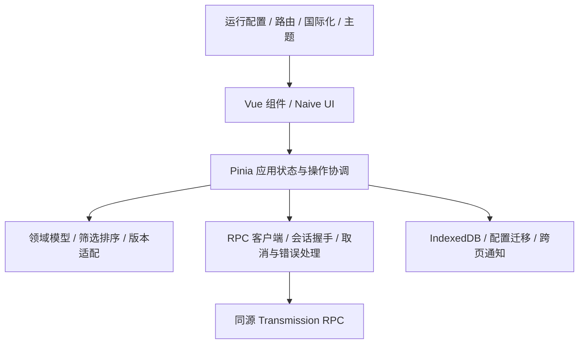

# Transmission Web UI


**简体中文** | [English](README.en.md)

面向 NAS、Docker 和 Linux 的现代化 Transmission Web 管理界面。以 Vue 3 + TypeScript 重构，提供任务管理、文件选择、Tracker 编辑、目录匹配、多语言和多种主题；通过 Transmission RPC 管理现有服务。

发布包是完整的 HTML / JavaScript / CSS 静态资源，运行时不需要 Node.js、npm、Python、数据库或外部 CDN。保留现有 Transmission 服务、下载任务与数据，群晖可使用单文件离线安装器完成接入。

2.1.0 增加浏览器本地诊断、手动日志导出和有限范围的离线故障重放；采集范围、保存位置和操作步骤见[诊断与重放说明](docs/diagnostics.md)。无需部署日志服务器。 遇到问题可使用[用户自查检查表](docs/diagnostics-self-check.md)，按步骤排查并整理反馈。

[下载发行版](https://github.com/nimbusking/transmission-web-ui/releases) · [反馈问题](https://github.com/nimbusking/transmission-web-ui/issues) · [项目博客](https://nimbusk.cc)

## 目录

- [功能概览](#features)
- [支持版本与环境](#compatibility)
- [安装与升级手册](#installation)
- [使用手册](#usage)
- [前端架构](#architecture)
- [本地开发与构建](#development)
- [常见问题](#faq)
- [文档索引与许可证](#docs)

<a id="features"></a>

## 功能概览

| 功能         | 说明                                                                                                                            |
| ------------ | ------------------------------------------------------------------------------------------------------------------------------- |
| 任务管理     | 添加种子文件、URL、磁力链接；启动、暂停、移除、重新校验、移动目录及队列操作                                                     |
| 列表与检索   | 状态、目录和标签筛选；名称多关键词搜索；排序、分页、虚拟表格及列显隐/顺序/宽度设置                                              |
| 任务详情     | 概览、文件、Tracker、Peer；分块完成情况画布及实时任务状态                                                                       |
| 文件管理     | 文件搜索、排序、分页；设置下载/跳过与优先级，按文件路径筛选                                                                     |
| Tracker 管理 | 编辑、添加、删除及批量替换；按 Transmission 版本适配分组能力                                                                    |
| 目录匹配     | 对暂停且元数据完整的任务匹配已有数据目录，定位并校验，支持日志与中断后核对继续                                                  |
| 参数与数据   | Transmission 服务端设置、目录字典、用户标签、分类导入导出及旧版配置迁移                                                         |
| 外观与语言   | Workbench / Console / Studio / Focus 四种布局；Modern / Metro / Material / Cupertino 四种皮肤；明暗模式、中英文及历史语言包回退 |
| 连接与状态   | 自动/手动刷新、连接过期提示、全局上下行速度和默认下载目录所在文件系统可用空间                                                   |
| 部署管理     | 静态离线包、群晖一体化安装、Docker 接入、备份、版本切换与恢复                                                                   |

<a id="compatibility"></a>

## 支持版本与环境

**支持 Transmission 3.00、4.0.x、4.1.4。** 已有真实 daemon 回归记录覆盖 3.00、4.0.0、4.0.6、4.1.4；界面按服务端版本和返回字段展示可用功能。

| 环境                                    | 安装方式                                                              |
| --------------------------------------- | --------------------------------------------------------------------- |
| SynoCommunity Transmission **4.1.4-32** | 一体化安装器自动检测、备份、接入与验证；本机群晖已部署                |
| 独立 Docker 容器                        | 一体化安装器，或手动挂载静态资源并设置环境变量                        |
| Docker Compose / Container Manager 项目 | 在原项目中添加卷与环境变量，保留原编排配置                            |
| Linux / 其他 Transmission 部署          | 独立安装器安装资源，通过服务支持的配置入口设置 Web 根目录             |
| 浏览器                                  | 支持 ES2022 的现代浏览器；项目提供 Chromium、Firefox、WebKit 测试入口 |

Transmission 3.00 使用旧版 Tracker 编辑方式；4.x 支持 `trackerList` 分组。UI 的版本兼容范围与自动安装器的环境支持范围不同：其他套件版本可按手动部署方式核对服务配置，不能直接套用 SynoCommunity 4.1.4-32 的接入脚本。

<a id="installation"></a>

## 安装与升级手册

### 1. 群晖一体化安装（推荐）

前提：NAS 已安装并启动 Transmission，能够访问原 Web 页面；准备管理员 SSH 访问权限和现有 RPC 账号密码。

1. 在 [Releases](https://github.com/nimbusking/transmission-web-ui/releases) 选择发行版，下载附件 **`install-transmission-web-ui.sh`** 及对应 `.sha256` 文件。
2. 将文件上传到 NAS，通过 SSH 进入文件所在目录，校验并执行：

   ```sh
   sha256sum -c install-transmission-web-ui.sh.sha256
   sudo sh install-transmission-web-ui.sh --check
   sudo sh install-transmission-web-ui.sh
   ```

3. 按提示选择套件或容器、输入认证信息，并确认必要的服务重启。安装器完成环境检测、旧资源备份、离线资源安装和页面/RPC 验证。
4. 保存输出的安装目录、访问地址和**备份目录**。打开提示地址，登录后检查任务列表和状态栏。

请下载 **Release 附件**：它内嵌完整离线包；源码仓库内同名文件是开发入口，不是离线交付包。首次接入可能重启服务，传输会短暂暂停；已受管理的纯 UI 升级及对应恢复只切换静态资源，不重启 Transmission。无需在 NAS 安装开发运行时，也无需替换现有 Transmission 镜像。

**群晖登录页：** 从 `2.0.0-installer.5` 起，支持的 SynoCommunity 4.1.4-32 环境在原端口为 9091 且启用认证时，默认 `--login-page auto` 使用 DSM 系统 nginx 提供网页登录入口，原 RPC 调整至 9093，保留账号密码。已有入口的升级与恢复由同一安装器管理。Docker 不自动配置该登录代理。参数和恢复机制见[一体化安装器](docs/integrated-installer.md)。

### 2. Docker / Compose 手动接入

先按下一节将静态包安装到宿主机独立持久化目录，再将以下内容合并到**已有 Transmission 服务**配置中（示例不是完整 Compose 文件）：

```yaml
services:
  transmission:
    volumes:
      - /your/persistent/path/transmission-web-ui:/web-ui:ro
    environment:
      TRANSMISSION_WEB_HOME: /web-ui/current
```

将 `/your/persistent/path/transmission-web-ui` 替换为实际安装目录。保留原镜像、配置卷、下载卷、端口、网络和运行用户，使用原部署工具应用配置。镜像须支持 `TRANSMISSION_WEB_HOME`，服务账户须能读取资源。

挂载整个受管理父目录，不要只挂载 `current`，以便升级时软链接切换能够在容器内生效。Container Manager / Docker 图形界面可添加相同的卷映射与环境变量；Compose/Swarm 管理的容器通过原编排配置更新，不交给一体化安装器自动重建。

### 3. Linux / 通用离线安装

下载同一发行版的 `install.sh`、`transmission-web-ui-<version>.tar.gz` 和 `.sha256`，下面以 UI 版本 2.0.0 为例；使用时按附件实际版本替换：

```sh
sha256sum -c transmission-web-ui-2.0.0.tar.gz.sha256
sh install.sh \
  --prefix /your/persistent/path/transmission-web-ui \
  --archive transmission-web-ui-2.0.0.tar.gz
```

在现有服务支持的持久化配置入口设置：

```text
TRANSMISSION_WEB_HOME=/your/persistent/path/transmission-web-ui/current
```

以原服务管理方式重启 Transmission，访问 `http://<主机>:<Web端口>/transmission/web/`。独立 `install.sh` 只管理资源，不自动改服务配置或重启。SynoCommunity 套件优先使用上一节一体化安装，其 XDG 接入细节见[群晖部署](docs/synology.md)。

### 4. 升级、回退与恢复

- **一体化安装升级：** 下载新发行版单文件安装器并再次执行，保留安装输出的备份目录；已管理的登录资源同步更新。
- **一体化恢复：** 使用安装器输出的具体备份路径执行：

  ```sh
  sudo sh install-transmission-web-ui.sh --restore /实际备份目录
  ```

- **手动安装升级：** 用相同 `--prefix` 安装新版本归档；完整准备后切换 `current`，旧版本保留。
- **手动版本回退：** 指定已安装版本，例如：

  ```sh
  sh install.sh --prefix /your/persistent/path/transmission-web-ui --rollback 2.0.0
  ```

升级或回退后刷新浏览器页面。静态资源恢复不撤销已经执行的任务操作或服务端参数修改；浏览器偏好与标签请通过界面导出备份。卸载前先恢复原 Web 接入；具体操作见[部署说明](docs/deployment.md)。

### 5. 反向代理与运行配置

UI 和 RPC 必须同源。默认 `app-config.json` 使用 `rpcUrl: "../rpc"`，例如页面 `/transmission/web/` 对应 `/transmission/rpc`；带前缀 `/nas/transmission/web/` 对应 `/nas/transmission/rpc`。

代理同时转发静态资源和 RPC POST，保留 `X-Transmission-Session-Id` 请求/响应头以及认证头，不缓存 RPC 或 409 响应。前端采用 hash 路由，无须额外 SPA 路由回退。HTTPS 应让 UI 和 RPC 共用协议、主机和端口。

```json
{
  "rpcUrl": "../rpc",
  "defaultLocale": "auto",
  "refreshIntervalMs": 5000
}
```

`app-config.json` 位于 Web 根目录；刷新间隔允许 2000–300000 毫秒。RPC 地址不接受跨源地址或内嵌用户名/密码。完整代理及登录配置见[部署说明](docs/deployment.md)。

<a id="usage"></a>

## 使用手册

### 1. 打开与登录

打开安装输出的地址或原 `/transmission/web/`，使用 Transmission RPC 账号密码连接。直接由 daemon 提供页面时，浏览器可能先显示 Basic 认证框；配置群晖集成登录入口后可在页面内登录。连接完成后，状态栏显示连接状态、速度、版本及空间信息。

### 2. 添加下载任务

点击工具栏“添加”，选择 `.torrent` 文件或输入 URL / magnet 链接，设置服务端下载目录及是否立即开始，确认后查看每项结果。目录是 **NAS/Transmission 服务端路径**，不是浏览器所在电脑的路径。容器中应填写容器内部下载路径。重复种子单独显示处理结果。

### 3. 搜索、筛选与批量操作

- 左侧导航按状态、目录、用户标签筛选；顶部搜索只匹配任务名称，空格分隔的多个关键词必须全部命中，顺序不限。
- 点击任务行打开详情；**批量操作需勾选复选框**，仅打开详情不等于勾选任务。
- 通过工具栏执行启动、暂停、移除、校验和队列操作；更多高级操作可从右键菜单进入。
- 右键未勾选行作用于该行；右键已勾选行作用于当前明确勾选集合。筛选、翻页后重新核对勾选范围。
- “更多”中的全部启动/全部暂停作用于当前连接的全部任务，确认框会列出目标，不受当前分页或筛选限制。
- 移除时核对是否同时删除本地数据；重新校验须确认，提交请求后等待实际校验完成。

### 4. 查看详情与管理文件

详情包含概览、文件、Tracker、Peer。概览显示任务属性和分块完成情况，鼠标悬停分块可查看范围、大小和完成率。详情右上角可收起面板。

文件页支持搜索、排序和独立分页；勾选文件后通过底部操作区设置下载、跳过或优先级。模板/路径正则用于筛选文件，先检查结果再执行操作。文件页中的“下载”表示让 Transmission 下载选中文件，不是把 NAS 文件传输到浏览器。

Tracker 页可编辑地址；4.x 可维护分组，3.00 使用适配的旧版操作。批量替换 Tracker 时先预览目标和结果，再确认提交。

### 5. 移动目录与匹配已有数据

需要搬运数据时使用移动目录操作，核对目标路径及是否移动文件。已有文件需要重新关联时，使用目录匹配：

1. 暂停任务并等待元数据完整，准备候选服务端目录。
2. 在目录匹配入口选择任务与候选目录，启动匹配。
3. 匹配使用 `move=false` 定位已有数据并校验，不搬运文件；部分匹配项等待人工选择。
4. 按结果决定继续、保留或恢复原目录并校验，可导出日志。
5. 页面刷新后先核对 daemon 状态，再“核对并继续”。取消只停止后续命令，已提交校验仍可能运行。

### 6. 设置、标签与配置备份

“设置”按基本设置、网络传输、带宽限制、时段限制、目录字典、额外设置、用户标签组织；只显示当前服务支持的参数。

- 语言、刷新间隔、每页条数等界面偏好即时保存。
- 服务端参数修改后点击**“保存服务端参数”**；关闭对话框不会提交草稿。时段限制采用 Transmission 所在设备时区。
- 目录字典提供常用路径；用户标签支持名称、说明、颜色以及任务关联，删除标签不删除任务。
- 底部“导入与导出”可分别选择界面偏好、目录字典、标签与关联、Transmission 参数。导出的是已保存内容。
- 导入先预览；服务端参数默认不选中，选择后还需核对差异并确认。旧版配置迁移详见[迁移说明](docs/migration.md)。

偏好和标签保存在浏览器 IndexedDB，并按 RPC 地址隔离。更换浏览器、域名、端口或入口时，先从旧入口导出，再在新入口导入。

### 7. 外观、刷新与状态栏

布局、皮肤、明暗模式分别控制界面结构、视觉风格和颜色模式。列设置可调整显隐、宽度与顺序；窄屏使用响应式任务视图。

自动刷新默认 5 秒，可在界面调整或关闭，关闭后用手动刷新更新。底部速度来自服务端全局统计，不受列表筛选影响；空间是默认下载目录所在文件系统的剩余空间，不是全部磁盘之和。连接异常时保留上次数据并标记过期，恢复连接后再确认任务状态。

<a id="architecture"></a>

## 前端架构



| 技术 / 目录                | 职责                                                 |
| -------------------------- | ---------------------------------------------------- |
| Vue 3.5 + TypeScript 5.9   | Composition API、组件交互与静态类型                  |
| Naive UI 2 + Lucide        | 表单、弹窗、虚拟表格和图标                           |
| Pinia 3 · `src/stores/`    | 任务实体、连接、详情选择、批量勾选和命令协调         |
| `src/domain/`              | 纯领域逻辑、归一化、筛选排序、版本能力与主题模型     |
| `src/services/`            | RPC、IndexedDB、分类配置交换、批处理和目录匹配状态机 |
| Vue Router 4 + Vue I18n 11 | hash 路由、语言加载与英文回退                        |
| idb 8 + Zod 4              | 本地事务存储及运行配置校验                           |
| Vite 7 · `public/`         | 相对资源路径、按需加载、运行配置与静态构建           |
| `release/` · `scripts/`    | 安装器、归档、完整性校验与验证工具                   |
| `tests/` · `lab/`          | 单元测试、浏览器测试、真实 daemon 隔离实验环境       |

组件负责交互和草稿，store 协调用例，领域层处理纯数据，服务层访问 RPC 与本地存储。详情选择与批量勾选分离；写操作捕获任务 hash 和连接代次，避免重连后操作错误任务。刷新共享请求链，详情按需读取；网络失败保留缓存并提示状态，不盲目重复写请求。

更多模块职责、同步周期、数据身份及扩展规则见[架构详解](docs/architecture.md)和[主题设计](docs/theme-design.md)。

<a id="development"></a>

## 本地开发与构建

开发需要 **Node.js >= 22.12**；Docker 仅用于实验服务和集成验证。

```sh
npm ci
npm run lab:up
npm run dev
```

打开 Vite 输出的地址。开发代理默认指向 `http://127.0.0.1:19091`，也可以指定已有测试服务：

```sh
TR_RPC_TARGET=http://127.0.0.1:9091 npm run dev
```

| 命令                                     | 用途                                                  |
| ---------------------------------------- | ----------------------------------------------------- |
| `npm run build`                          | 类型检查及生产构建，输出 `dist/`                      |
| `npm run check`                          | lint、类型、单元测试、构建、体积检查                  |
| `npm run format:check`                   | 代码格式检查                                          |
| `npm run spec:validate`                  | OpenSpec 规范校验（需可用的 `openspec` CLI）          |
| `npm run test:e2e:docker -- --workers=3` | Docker 浏览器测试，前置条件见验证文档                 |
| `npm run test:rpc`                       | 真实服务 RPC 验证                                     |
| `npm run release`                        | 构建静态包、摘要和单文件离线安装器，输出 `artifacts/` |
| `npm run lab:down`                       | 停止实验环境，保留数据卷                              |

后续自行打包 NAS 离线安装器：

```sh
npm ci
npm run package:nas -- --version 2.1.3-status.2
```

在 Linux / WSL 开发电脑运行，需要 Node.js >=22.12、GNU tar 和 POSIX sh。脚本执行单元测试、安装器回归测试、生产构建、打包与 SHA256 校验，默认输出到 `artifacts/nas-<版本>/`；可用 `--output-dir <目录>` 指定输出目录（相对仓库根目录）。目录必须为空或不存在。上传其中的 `install-transmission-web-ui.sh` 及 `.sha256` 到 NAS，按上文安装步骤执行。归档版本用于安装与回退，不修改 `package.json` 中的界面版本；每次部署请指定新版本，避免安装器拒绝同版本覆盖。

新旧 UI 对照仅用于开发，需额外提供历史 Web 资源路径 `TWUI_LEGACY_WEB_ROOT` 后运行 `npm run compare:up`，见[本地对照说明](docs/local-comparison.md)。测试步骤与证据见[验证文档](docs/validation.md)。不要并发构建和测试同一 `dist/`。生成本地发行文件不会自动上传 GitHub Release。

<a id="faq"></a>

## 常见问题

| 问题                            | 处理方式                                                                       |
| ------------------------------- | ------------------------------------------------------------------------------ |
| 升级后仍是旧页面 / 资源加载失败 | 刷新页面并检查代理缓存；确认服务指向 `current`，容器挂载的是父目录             |
| 页面可打开但 RPC 连接失败       | 检查同源 RPC 地址、认证、代理 POST 和会话头；409 是正常握手的一部分            |
| 浏览器先弹账号密码框            | daemon 直接保护 HTML 时属于正常 Basic 认证；页面内登录需配置集成入口或同源代理 |
| 操作按钮不可用                  | 检查连接、忙碌状态与复选框勾选；任务行高亮只代表详情选择                       |
| 设置关闭后没有生效              | 服务端草稿需要点击“保存服务端参数”，界面偏好才是即时保存                       |
| 换域名后标签/偏好不见           | 浏览器存储按来源和 RPC 地址隔离，从原入口导出再导入                            |
| 下载目录无效 / 权限不足         | 使用 daemon 可访问的路径，核对服务账户权限和容器卷映射                         |
| 安装器拒绝当前环境              | 查看输出原因；编排容器用原项目配置接入，其他环境参考手动部署                   |

<a id="docs"></a>

## 文档索引与许可证

以下深入文档目前以中文维护；英文 README 同样包含安装和使用手册。

- [安装、升级、卸载与反向代理](docs/deployment.md)
- [一体化安装器参数与恢复](docs/integrated-installer.md)
- [群晖套件与容器接入](docs/synology.md)
- [配置迁移与存储语义](docs/migration.md)
- [架构详解](docs/architecture.md) · [主题设计](docs/theme-design.md)
- [测试与复现](docs/validation.md) · [验证证据](docs/validation-evidence/README.md)
- [开发进度](docs/implementation-progress.md) · [需求追踪](docs/traceability.md)
- [OpenSpec 设计](openspec/changes/rebuild-transmission-web-ui/design.md) · [任务](openspec/changes/rebuild-transmission-web-ui/tasks.md)

本项目采用 [MIT License](LICENSE)。本发行版不包含旧实现；历史源码可通过 Git 历史查看。
