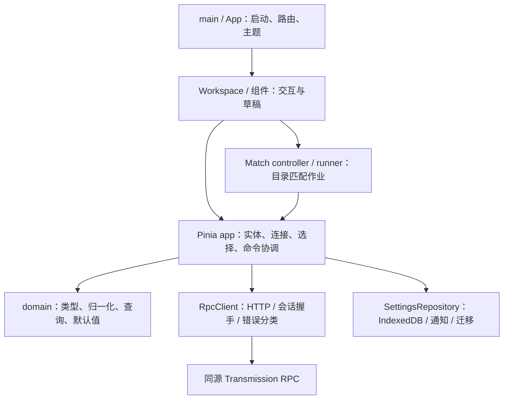

# 新框架架构与维护入口

本文件描述已实现的结构；需求依据是 `project_outline.md` 第 17–21 节和 `openspec/changes/rebuild-transmission-web-ui/`。旧实现只保留在 `old/` 作为行为参考，816 文件摘要由 `check:legacy` 校验。新框架不继承旧 jQuery/EasyUI 的对象与事件生命周期。

## 模块边界

| 入口 | 职责 |
| --- | --- |
| `src/main.ts`、`App.vue` | hash 路由、语言初始化、Naive UI Provider、主题与系统偏好 |
| `src/components/Workspace.vue` | 分类/查询、页内选择范围、操作入口、弹窗与底部详情布局 |
| `TorrentTable.vue`、`DetailPane.vue`、`PieceMap.vue` | 虚拟表格、字段布局、按需详情、原始文件索引、最多 512 单元的分片画布 |
| `AddDialog.vue`、`ActionDialog.vue` | 添加队列与一次性参数、捕获目标、确认、配置草稿 |
| `SettingsDialog.vue`、`WorkflowDialog.vue` | 导入预览、服务端差异确认、手动服务、Tracker 预览和目录匹配决策 |
| `src/stores/app.ts` | 单实例状态和用例协调；组件通过 store 更新业务状态/持久化 |
| `src/domain/` | 无网络领域逻辑、实体合并、筛选排序、字段和数据类型 |
| `src/services/rpc.ts` | RPC transport、认证、409 握手、超时/取消/错误与版本核对周期 |
| `settings.ts`、`session-fields.ts` | 本地 schema/迁移/事务和 daemon 可写字段白名单 |
| `batch.ts`、`workflow.ts`、`match-controller.ts` | 通用逐项结算、可测试匹配状态机、页面间作业控制 |
| `src/i18n/` | 中英新文案、14 个历史语言包与英文回退；异步加载防旧请求覆盖 |
| `release/`、`scripts/release.mjs` | 独立安装器、只读群晖预检、静态归档与完整性清单 |

## 状态所有权和身份

实体保存在浅响应式 `Map<id, Torrent>`，未变化的实体保留引用。分类、排序、统计和显示字段从实体派生，不回写实体。详情选择 `selectedId`、批量勾选 `checkedIds`、当前详情、编辑草稿分别维护，轮询不重置草稿。

每次连接产生新 generation；操作目标捕获 `{id, hashString, generation}`。写前核对当前连接和 hash，实际写 RPC 使用 hash。空目标被拒绝，避免服务端把空集合解释为全部任务。右键未勾选行只操作该行，右键已勾选行使用明确的勾选集合。详情请求同时检查序号、选择和 generation；写入成功后的界面更新也检查原目标，避免晚到响应清掉另一任务的新草稿。

## 同步和请求生命周期

启动先读取运行配置和本地偏好，再 session-get 和完整列表。普通刷新默认 5 秒，最低 2 秒；后台 30 秒并暂停普通详情请求。会话 30 秒核对，完整列表每 60 秒核对；Transmission 4.0.0–4.0.5 缩短为 15 秒。恢复前台执行全量核对。

完整快照、recently-active 增量和缺失基础字段补齐共享一个刷新 Promise；重叠的全量需求延后执行。增量缺少 hash/目录的新实体在补齐后才可捕获目标。刷新失败保留缓存和 stale 提示，旧连接结果不能修改新连接。会话身份变化触发重新连接并清理旧选择。

RPC 默认超时 20 秒；409 最多重新握手发送两次。其他写失败不自动重试；网络/超时等无法确定服务端是否已经接受的情况报告 unknown。用户取消批量只停止未发送项，已发送项继续结算。普通批量并发 3，移动/校验串行。Transmission 没有跨命令事务，因此不把多步 Tracker 更新或目录匹配描述为原子操作。

## 版本适配与工作流

Transmission 3.00 Tracker 编辑采用扁平位置/URL 对，先替换再删除/新增；4.0.x 使用 trackerList 保留 tier。3.00 多步更新部分失败后重新读取，保留原始错误。wanted 的 number/boolean 统一归一化。文件添加走 metainfo，URL/magnet 走 filename；重复返回单独结算。有效完成大小是 totalSize-leftUntilDone，不使用累计下载量替代。

目录匹配 runner 只处理暂停且元数据完整的任务，move=false 定位，发起校验后读取实际状态直到完成。完整文件集满足才 matched；partial 停该项等待决定，后项继续。30 分钟未完成转待核对。取消不撤销已送达的校验；恢复原目录也必须等待重新校验结束。作业日志持久化，刷新后运行状态转 interrupted，只有显式核对并继续才重放。正在匹配的任务拒绝冲突的普通命令。

## 存储和发布边界

设置使用 schemaVersion 2，按 RPC origin+pathname 隔离；IndexedDB 事务更新字段，BroadcastChannel 通知其他页面重读已提交值。标签使用稳定 ID，通过 torrent hash 映射。本地导入保存输入原文和导入前设置，不删除旧 localStorage 键。daemon 参数通过独立差异确认和可写字段白名单应用；详见 [迁移说明](migration.md)。

生产端只有 HTML/JS/CSS/JSON，不提供应用后端、不请求 CDN。外部 IP、Tracker 列表和更新检查只由用户手动触发。相对资源与默认 `../rpc` 支持代理路径，RPC 强制同源，凭据只存当前页内存。

安装器将完整资源写入独立 prefix/releases/version，准备完成才切换相对 current 链接；不覆盖官方 UI、不修改供应方启动脚本。Docker 挂载整个 prefix 父目录。安装与运行不需要 Node/npm/Python；开发工具和实验镜像不进入归档。SynoCommunity 4.1.4-32 已提供核对实际进程后的 XDG 接入；真实 DSM 的环境、ACL 和生命周期仍须验证，详见 [部署说明](deployment.md) 和 [群晖说明](synology.md)。

## 变更后的验证选择

- RPC/同步/身份变更：对应 unit、`test:rpc` 与真实四版 daemon 浏览器流程。
- 操作与匹配变更：store/workflow unit、`test:controls`、`test:match`；涉及界面再运行 Playwright。
- 存储/迁移变更：settings unit、迁移/跨标签页/服务端差异浏览器用例。
- 列表/详情渲染变更：三浏览器布局、10,000 文件和规模专项；性能路径变更需重跑完整 30 分钟。
- 安装/归档变更：安装器故障注入、BusyBox 离线部署和运行中 daemon 切换；不能用 Linux 模拟替代 DSM 验收。

先完成生产构建，再运行使用该构建的浏览器测试。长测期间冻结 dist；额外候选构建使用独立目录和端口，记录各自资产摘要。完整命令与实测范围见 [验证记录](validation.md)。
