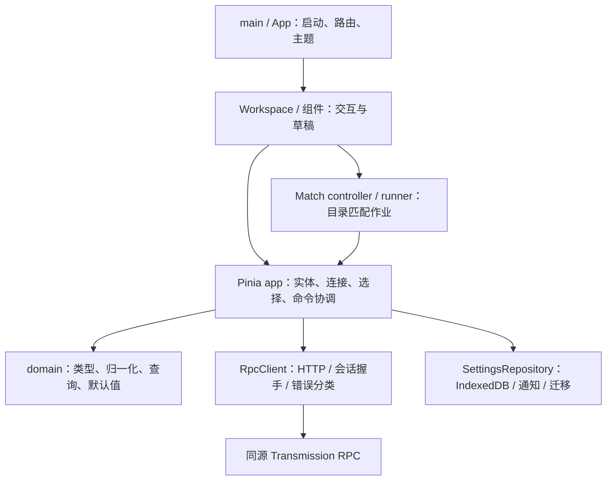

# 新框架架构与维护入口

设置实际状态修正（2026-11-16）：SettingsDialog.initialDaemon改为响应式保存基线，保存/服务端导入成功读回后清除对应差异；失败草稿不丢失。watch仅订阅既有app.session及busy，未编辑alt-speed-enabled随最近会话读取更新，已编辑开关和其他字段草稿保留；时段页单独显示最近daemon模式，连接过期时显示不可用，不添加独立轮询或隐式写入。4.0.0启用或准备启用uTP时，在网络/带宽/时段显示实际超速风险和仅暂存关闭入口，仍需原保存按钮提交，不自动启停任务。scripts/test-settings-runtime.mjs与tests/runtime/settings.spec.ts属于开发验证，使用独立临时四版daemon、私有自有数据和本地TCP peer，不加入Release运行依赖。

设置输入深色统一修正（2026-11-16）：SettingsDialog根使用abstract NConfigProvider，不添加DOM并继承父theme/locale/namespace；settingsAppearance按已有dark注入和visualProfile集中定义Input及InputNumber/AutoComplete/TimePicker/Select/ColorPicker的实际内部peer。启用用subtle底色、muted边框和text文字；禁用用canvas底色、muted边框/文字；悬停/聚焦/展开沿用accent与selected，不覆盖错误警告色。浅色返回undefined并完整继承父主题，设置外不改。原D35单独pathInputAppearance已移除，路径标题命中/名称修正继续保留，同行布局/数值/数据/保存方式均不变。此次统一覆盖取代此前“仅路径深色修正”的范围，避免新增控件再次遗漏。

设置短参数同行（2026-11-16）：SettingsDialog的fieldRows只合并相邻且已有启用依赖的boolean/普通number，排除时段值；字段身份/顺序/能力过滤保持。全部数字（含时段/星期）和加密使用局部compact行，数值160px、时间150px、短选项210px；同行组合数值210px以容纳KB/s/分钟后缀。行最大720px，短控件起始列统一，星期保留宽控制组。已有三个界面偏好（语言/刷新间隔/每页条数）同样同行；路径/脚本/URL/多行区域仍宽布局。组合内原数值label仅视觉隐藏、关联名称保留；不改值、RPC、存储和既有保存模式。600px以下短控件缩到130px、选项160px，标签/星期可换行，固定分类栏与底部操作继续保留。

默认目录控件边界修正（2026-11-16）：SettingsDialog仅对download-dir取消整行label的for指针关联，使用inputProps.aria-labelledby保留名称；默认NAutoComplete负责本体焦点、选择及键盘，不增加外部点击触发。pathInputAppearance订阅已有color-mode-dark注入与当前visualProfile，仅在深色用局部AutoComplete.peers.Input覆盖底色/边框/焦点，不更改全局Provider或浅色、目录建议来源、RPC与存储。

设置页（2026-11-16）：SettingsDialog按旧版七分类组织，domain/settings-layout提供全部47个session字段的唯一归类、启用依赖及HH:mm/星期转换；只展示当前session存在且版本允许的字段。基本设置保留现有即时保存的界面偏好，服务端仍为显式保存的共享草稿，只提交变化字段；关闭不提交。时区采用daemon本地时区。长表单正文滚动，分类栏和底部操作保持可达。端口/黑名单使用当前已保存配置，控件提示先保存修改。旧版额外设置新增选项按用户最新指令暂缓，导航/目录筛选/右键范围未改；已有手动服务保留。

配置交换由services/settings-transfer独立解析format=transmission-web-ui/formatVersion=1的分类信封，ui/folders/labels/server可独立选择；持久化仍schemaVersion=2。兼容v2全量、旧v1及labels/maps；服务端默认不选，继续白名单/版本过滤和独立差异确认。本地导入在同一IndexedDB事务内保留原始输入和前值，仅替换选中分类，未选择分类取事务时最新值，跨页面通知沿用。标签定义和hash关联作为一个原子分类整体替换，批量删除只清理选中稳定ID；界面重置仅更新ui。脚本test:settings只属于开发验收，使用四个一次性无网络/无数据卷daemon，不加入Release运行依赖。

名称搜索补充（2026-11-16）：domain/name-search.ts的createNameMatcher在一次selectTorrents调用中将查询做NFKC/toLowerCase、Unicode空白分词及去重，非空查询只标准化并检查t.name，全部词必须为字面子串且顺序不限；空查询直接接受，不改原始名称、不搜索hash/downloadDir、不评分或纠错。保留原导航交集和排序、Workspace的120ms防抖及分页/勾选清理，不新增RPC或持久化字段。主列表中英文提示同步说明名称和空格分词；文件详情过滤不变。scripts/test-name-search.mjs仅将生产领域模型编译至独立.lab目录做开发短测，不改dist或进入Release。

关于字体验收补充：主体在about-content局部设置15px/1.65和正常text色，简介/字段/许可继承，版本标记保留accent、标题24px；按钮通过局部deep选择器继承主体字号，避免Naive独立字号混用，不调整全局字体或palette。

关于入口补充（2026-11-16）：Workspace在主题右侧提供Info按钮与临时open状态，AboutDialog通过defineAsyncComponent首次打开才加载，Naive浮层沿用当前namespace/皮肤与焦点返回，并提供显式可访问名称。Logo复用BrandMark静态版；UI版本读取package.json，Transmission/RPC直接读取store.session，连接未就绪/过期时明确缓存，缺失时显示未连接/未知，不新增RPC或设置字段。src/project.ts集中维护当前仓库/文档/博客/许可证链接，只有用户点击才导航新标签；许可证/外链采用noopener noreferrer。660px宽度在全局dialog样式中约束以覆盖Teleport根节点，内容样式局部化，窄屏复用图标入口和可换行居中按钮。

外观三层：LayoutPicker管理既有layoutTheme布局，ThemePicker管理visualTheme皮肤（Modern/Metro/Material/Cupertino），ColorModeToggle管理theme明暗。旧v2缺失/未知皮肤仅补modern，其他设置不变。domain/visual-themes.ts集中palette和Naive类型化覆盖，App同步根变量并向浮层提供skin-ID-mode namespace；卸载恢复变量。visual-themes.css只改变视觉，themes.css只处理布局；矩形进度、行度量和业务状态保持。扩展规则见[主题设计规范](theme-design.md)。

列设置响应补充：ColumnSettingsDialog独立于Workspace模板，首次show才挂载NModal（先隐藏挂载一个nextTick，确保首次也使用淡入），之后display-directive=show复用23行控件。关闭后控件驻留但退出焦点陷阱/可访问树，其他弹窗保留原行为。卡片和同容器遮罩仅120ms透明度过渡，无大幅缩放；prefers-reduced-motion下0ms。列保存仍通过app.updateUi按字段更新，开关不请求RPC或保存设置；用驻留DOM/内存换重复打开避免重建，不改变初始进入页面的控件开销。

详情收起补充：Workspace只在list-region处理空白左键点击，任务行/移动卡片/表头/交互控件/滚动条均受保护，不增加全局click、blur或visibility监听。select(null)释放详情/错误/加载状态并取消请求、递增序号，checkedIds独立保留；详情右上角提供带文字的收起入口。新的H样例属于本机comparison夹具，不进入Release。

分块展示补充：PieceMap独占概览底部整行，ResizeObserver按内容宽度计算约18px方格/4px间距，高清Canvas最多512格。domain/pieces一次解码聚合，保留每格原始范围、实际大小与字节完成率，按totalSize截断最后一块；未知大小显示未知。指针命中排除间隙/末行空白，单个Naive UI提示层展示大小×两位小数百分比与块范围。宽度/数据变化、滚动、离开和卸载清理提示；卸载释放观察/监听，复用原详情轮询，无新增请求或逐块DOM。

本文件描述已实现的结构；需求依据是 `project_outline.md` 第 17–21 节和 `openspec/changes/rebuild-transmission-web-ui/`。本发行版已移除旧实现及其摘要校验流程，历史源码可通过 Git 历史查看。新框架不继承旧 jQuery/EasyUI 的对象与事件生命周期。

## 模块边界

| 入口 | 职责 |
| --- | --- |
| `src/main.ts`、`App.vue` | hash 路由、语言初始化、Naive UI Provider、主题与系统偏好 |
| `src/components/Workspace.vue` | 分类/查询、页内选择范围、操作入口、弹窗与底部详情布局 |
| `TorrentTable.vue`、`DetailPane.vue`、`PieceMap.vue` | 虚拟表格、字段布局、按需详情、原始文件索引、最多 512 单元的分片画布 |
| `AddDialog.vue`、`ActionDialog.vue` | 添加队列与一次性参数、捕获目标、确认、配置草稿 |
| `SettingsDialog.vue`、`WorkflowDialog.vue` | 导入预览、服务端差异确认、手动服务、Tracker 预览和目录匹配决策 |
| `src/stores/app.ts` | 单实例状态和用例协调；组件通过 store 更新业务状态/持久化 |
| `src/domain/` | 无网络领域逻辑、实体合并、筛选排序、字段和数据类型 |
| `src/services/rpc.ts` | RPC transport、认证、409 握手、超时/取消/错误与版本核对周期 |
| `settings.ts`、`session-fields.ts` | 本地 schema/迁移/事务和 daemon 可写字段白名单 |
| `batch.ts`、`workflow.ts`、`match-controller.ts` | 通用逐项结算、可测试匹配状态机、页面间作业控制 |
| `src/i18n/` | 中英新文案、14 个历史语言包与英文回退；异步加载防旧请求覆盖 |
| `release/`、`scripts/release.mjs` | 独立安装器、只读群晖预检、静态归档与完整性清单 |

## 状态所有权和身份

实体保存在浅响应式 `Map<id, Torrent>`，未变化的实体保留引用。分类、排序、统计和显示字段从实体派生，不回写实体。详情选择 `selectedId`、批量勾选 `checkedIds`、当前详情、编辑草稿分别维护，轮询不重置草稿。

每次连接产生新 generation；操作目标捕获 `{id, hashString, generation}`。写前核对当前连接和 hash，实际写 RPC 使用 hash。空目标被拒绝，避免服务端把空集合解释为全部任务。右键未勾选行只操作该行，右键已勾选行使用明确的勾选集合。详情请求同时检查序号、选择和 generation；写入成功后的界面更新也检查原目标，避免晚到响应清掉另一任务的新草稿。

## 同步和请求生命周期

启动先读取运行配置和本地偏好，再 session-get 和完整列表。普通刷新默认 5 秒，最低 2 秒；后台 30 秒并暂停普通详情请求。会话 30 秒核对，完整列表每 60 秒核对；Transmission 4.0.0–4.0.5 缩短为 15 秒。恢复前台执行全量核对。

完整快照、recently-active 增量和缺失基础字段补齐共享一个刷新 Promise；重叠的全量需求延后执行。增量缺少 hash/目录的新实体在补齐后才可捕获目标。刷新失败保留缓存和 stale 提示，旧连接结果不能修改新连接。会话身份变化触发重新连接并清理旧选择。

RPC 默认超时 20 秒；409 最多重新握手发送两次。其他写失败不自动重试；网络/超时等无法确定服务端是否已经接受的情况报告 unknown。用户取消批量只停止未发送项，已发送项继续结算。普通批量并发 3，移动/校验串行。Transmission 没有跨命令事务，因此不把多步 Tracker 更新或目录匹配描述为原子操作。

## 版本适配与工作流

Transmission 3.00 Tracker 编辑采用扁平位置/URL 对，先替换再删除/新增；4.0.x 使用 trackerList 保留 tier。3.00 多步更新部分失败后重新读取，保留原始错误。wanted 的 number/boolean 统一归一化。文件添加走 metainfo，URL/magnet 走 filename；重复返回单独结算。有效完成大小是 totalSize-leftUntilDone，不使用累计下载量替代。

目录匹配 runner 只处理暂停且元数据完整的任务，move=false 定位，发起校验后读取实际状态直到完成。完整文件集满足才 matched；partial 停该项等待决定，后项继续。30 分钟未完成转待核对。取消不撤销已送达的校验；恢复原目录也必须等待重新校验结束。作业日志持久化，刷新后运行状态转 interrupted，只有显式核对并继续才重放。正在匹配的任务拒绝冲突的普通命令。

## 存储和发布边界

设置使用 schemaVersion 2，按 RPC origin+pathname 隔离；IndexedDB 事务更新字段，BroadcastChannel 通知其他页面重读已提交值。标签使用稳定 ID，通过 torrent hash 映射。本地导入保存输入原文和导入前设置，不删除旧 localStorage 键。daemon 参数通过独立差异确认和可写字段白名单应用；详见 [迁移说明](migration.md)。

生产端只有 HTML/JS/CSS/JSON，不提供应用后端、不请求 CDN。外部 IP、Tracker 列表和更新检查只由用户手动触发。相对资源与默认 `../rpc` 支持代理路径，RPC 强制同源，凭据只存当前页内存。

安装器将完整资源写入独立 prefix/releases/version，准备完成才切换相对 current 链接；不覆盖官方 UI、不修改供应方启动脚本。Docker 挂载整个 prefix 父目录。安装与运行不需要 Node/npm/Python；开发工具和实验镜像不进入归档。SynoCommunity 4.1.4-32 已提供核对实际进程后的 XDG 接入；真实 DSM 的环境、ACL 和生命周期仍须验证，详见 [部署说明](deployment.md) 和 [群晖说明](synology.md)。

## 变更后的验证选择

- RPC/同步/身份变更：对应 unit、`test:rpc` 与真实四版 daemon 浏览器流程。
- 操作与匹配变更：store/workflow unit、`test:controls`、`test:match`；涉及界面再运行 Playwright。
- 存储/迁移变更：settings unit、迁移/跨标签页/服务端差异浏览器用例。
- 列表/详情渲染变更：三浏览器布局、10,000 文件和规模专项；性能路径变更需重跑完整 30 分钟。
- 安装/归档变更：安装器故障注入、BusyBox 离线部署和运行中 daemon 切换；不能用 Linux 模拟替代 DSM 验收。

先完成生产构建，再运行使用该构建的浏览器测试。长测期间冻结 dist；额外候选构建使用独立目录和端口，记录各自资产摘要。完整命令与实测范围见 [验证记录](validation.md)。

## 多级导航与统计（2026-11-15）

`SidebarNavigation.vue` 统一渲染状态、Tracker服务器、保存路径、daemon统计和标签；`domain/navigation.ts`负责服务器authority、路径前缀树、去重聚合和警告判断。节点用类型前缀和完整身份作为key；树只渲染展开后的可见窗口，行高34px，ResizeObserver跟随可用高度。图标来自按需导入的 `@lucide/vue`，许可位于public/licenses/lucide.txt，随离线静态包提供。

展开只改变本地偏好；节点选择由Workspace协调，状态/目录/服务器/标签取交集。全部任务清除导航条件、保留搜索。筛选变化按原规则清理页内勾选；消失节点保留条件和清除入口。目录使用路径段边界，父路径包含本目录和子目录；Tracker按主机和有效端口归组，单组内按任务去重，不暴露announce查询参数。

统计复用既有串行refresh的session-stats，以SessionStatistics表达累计/当前会话的嵌套计数，不新建轮询。重连先清空统计，旧generation响应不能写入；同连接失败保留过期数据。展开偏好为v2中的可选navigationExpanded，SettingsRepository事务内按节点合并，最多5000条，旧数据缺省可直接读取，不要求清空IndexedDB。

## 完整任务表格与分页（2026-11-15）

DEFAULT_COLUMNS为旧版20个业务列顺序，PREVIOUS_DEFAULT_COLUMNS仅用于精确识别原9列出厂布局；后者有任意顺序/宽度/可见性变化便不自动替换。migrateSettings为精确旧默认补columnPresetVersion和columnsBackup；SettingsRepository.load在同一readwrite事务持久化升级与备份，columnPreset在事务内应用完整预设或恢复上一份列布局，不动导航/标签/字典。

TorrentTable保持固定行高与虚拟滚动，独立行号按当前分页偏移+页内排序位置生成；任务ID和捕获目标仍使用原身份。domain/table.ts只负责表格局部二位精度、合法日期、服务器authority和未知人数；不改变详情/导航的格式精度。校验阶段显示recheckProgress并在提示中保留完成进度。未知Tracker人数保留未知，真实0正常显示；名称/错误/路径始终作为文本。

进度列独立禁用ellipsis包装，使用占满单元格的20px矩形、比例填充和居中数字，列内左右6px留白，无100px上限；0/100和未知沿用progressValue，校验含义放入title及aria-valuetext。填充/文字均为无交互span，点击沿用行事件，不引入组件轮询。保留32px虚拟行配置，当前Naive UI实际数据行约35px，矩形不额外撑高；此局部外观改动不调整全表文字行高。

列头原生拖动通过稳定key换序，宽度和键盘调整入口保留；标签编辑独立捕获被点击行，阻止冒泡，不采用当前批量勾选集合，单任务草稿预填原标签。Workspace底部提供记录范围、页/总页、跳页和每页10至5000条；切条数清勾选、回第一页、按UI字段保存，不新增RPC或把分页改成服务端分页。

Playwright配置接受TWUI_REPORT_DIR，Docker包装器传入该变量；并行运行还必须各自指定--output，报告与trace不能共享清理目录。完整性能构建和证据必须与本轮表格代码匹配。

## Logo 下方统一工具栏（2026-11-15）
WorkspaceToolbar为展示/事件组件，Workspace保留目标计算、operate捕获、弹窗及刷新协调。workspace三行grid为66px页头/48px全宽工具栏/左右内容；移动页头58px，导航覆盖从106px开始。toolbar仅横向滚动、隐藏竖向溢出、使用细滚动条，列设置不再受desktop-only隐藏。按钮使用Lucide SVG、title和翻译后的aria-label，装饰SVG隐藏。常用快捷入口与原更多菜单共用operate，改名单目标限制前移到禁用态；队列独立下拉与原菜单同一命令映射。自动刷新控件只调用updateUi，秒数2–300换算毫秒，与设置页和原单一schedule一致，不新增轮询、schema或RPC。

工具栏勾选修正：Workspace将工具栏targetCount直接绑定checkedIds.length，operateChecked发送前检查ready/busy/非空并复制勾选ID；operate强制显式ids参数，不再默认回退selectedId。selectedId只维持详情行高亮，右键与标签入口各自显式传目标。工具栏无勾选时任务按钮/队列/更多均禁用；添加/刷新/设置/列设置不受此条件影响。

校验图标使用已安装Lucide的DatabaseSearch：工具栏18px、导航16px、列表状态沿用原尺寸；单一图形映射不新增组件/依赖或改变校验命令。

## 重新校验二次确认（2026-11-16）
Workspace将verify从立即commands移除，三个直接入口统一捕获明确目标并打开ActionDialog。该组件冻结目标与名称，默认焦点取消，显式“开始校验”才execute(torrent-verify)；submit有busy重入保护，执行尝试后禁用整批再次确认，部分失败/unknown须核对并重新选择，避免重发已经接受的项。成功仅通知请求已提交；状态/校验进度仍走既有刷新。忙碌时弹框内提供取消后续项，已送达请求继续结算。移动后显式勾选校验仍包含在移动确认中，匹配runner内部校验不插弹窗。底层hash/generation、串行verify、错误分类和RPC不变。

## 更多批量与自动刷新（2026-11-16）
WorkspaceToolbar更多菜单使用独立moreMenu，只保留stopAll/startAll/replaceTrackers；更多按连接可用/非空/忙碌启用，Tracker条目额外要求勾选，普通快捷与队列仍按checkedIds启用。Workspace.operateBulk先refreshSnapshot等待当前/延后读取链结束，再完整快照后捕获全连接任务hash/generation，ActionDialog默认取消并确认名称/数量，不受视图筛选/页/勾选限制；新任务不隐式加入已打开的确认。ActionDialog映射正常torrent-start/torrent-stop，不发送空ids，不使用强制启动，失败后不在原框重复整批。完整右键menu保持独立，原高级操作仍可从右键进入。

工具栏秒数和设置页毫秒输入随autoRefresh禁用，关闭时保留值。visibilityChanged仅自动开启时恢复前台全量；schedule尊重disposed和autoRefresh，dispose清pendingFull/递增generation并中止请求，晚到回调不会重挂计时器或写过期状态。周期依旧一个setTimeout链，最短2秒/后台30秒，refresh共享请求；refreshSnapshot仅供明确全局操作的最新范围核对，不新增轮询。

列设置入口清理（2026-11-16）：列设置只保留显隐/宽度/顺序，不再显示应用旧版完整列表/恢复上一份列布局；Workspace/resetColumns、store界面包装与两条文案已删除。历史columnPresetVersion/columnsBackup读取与迁移保留在设置仓库内部，不主动回退/重置用户布局。

左下外观入口修正：sidebar-bottom为工作区第一列第三行底部覆盖层，与侧栏共同预留72px；文字组和唯一ColorModeToggle横排，按钮不再fixed。侧栏/主区明确grid位置，避免覆盖层改变自动布局；专注轨道/移动关闭时隐藏文字，移动展开显示同排。

暗色顶部搜索由Workspace局部Input.theme-overrides增强，依有效明暗及visualProfile派生subtle/默认muted框线/hover-focus accent；浅色不传覆盖。全局Input和其他表单、原搜索watch及数据选择保持。

## 全宽状态栏与空间读取（2026-11-16）
WorkspaceStatusbar占独立grid末行，横跨所有列；四布局共享32px+safe-area高度，移动详情和导航覆盖层止于其上沿，窄屏栏内滚动。页头连接/速度及侧栏版本移入，太阳/月亮保持左下；版本从package.json构建注入。

速度直接消费既有session-stats.downloadSpeed/uploadSpeed（B/s），不与列表筛选关联。新增freeSpace快照由同一串行refresh调用free-space(path=session.download-dir)，不增加定时器；5秒超时，失败仅清空间值/保留错误，成功列表与速度仍可更新。generation和路径防晚到污染，重连清空session/统计/空间。非负有限数才格式化，0有效、缺失或-1未知；整体刷新失败保留旧值并在状态栏标记过期。默认目录配置仍随原session-get最多30秒更新，空间是其所在文件系统可用量，不汇总所有磁盘。只读四版本脚本scripts/test-statusbar-readonly.mjs以全新无网络无卷daemon的free-space与statvfs对照，未操作对照任务。

## 文件分页与控制区（2026-11-16）
DetailPane文件页用domain/torrent-files合并原始index/files/fileStats（wanted/priorities回退），全量筛选/排序再切片，远程模式的NDataTable只负责页内虚拟渲染和排序事件，避免组件先分页后局部排序。文件下载量取当前fileStats.bytesCompleted。切页/筛选/排序/条数/任务清勾选，刷新钳页并保留当前页合法index；命令沿用原targets捕获/hash/generation，不把页内序号当RPC索引。filePageSize为v2独立偏好，默认200、10–5000、事务/跨页同步；页码/筛选不持久化且不影响主任务pageSize。

文件表下方独立footer放计数/分页与刷新/下载/跳过/优先级/模板/路径正则，控制区不随虚拟表格滚走；移动留44px避让左下明暗入口。局部双类选择器约束输入/选择器宽，防Naive运行时100%样式撑满。三个模板只是筛选，现有文件RPC元数据仍整批读取；不新增后端、定时器或分页RPC，关闭详情释放逻辑保持。

## 任务配置入口移除（2026-11-16）
按用户追加条件取消任务配置改造，DetailSection与详情加载路由仅保留general/files/trackers/peers；DetailPane不再维护通用任务参数草稿/提交表单。文件/Tracker重命名和其他对话框自身草稿仍独立保留，取消任务tab时保留全局设置；第34节已将SettingsDialog迁至专属设置表单布局，不恢复任务配置入口。取消前设计为历史依据，不是当前API；隔离3.00输入边界失败不等于所有参数或四个版本不受支持，具体证据见validation.md。

## 2026-11-16 共用兼容性修复增量

按既有OpenSpec第30节实施；选择身份、真实持有量/未知值、方向独立限速、Tracker完整基线及3.00挡板见[实施与验收记录](shared-compatibility-implementation-2026-11-16.md)。证据区分真实daemon回读、受控故障/浏览器与已有测试失效。无持久化schema迁移，无新轮询或任务配置tab；19080/19081只读，G4未发布，13.12长测待办保持开放。
