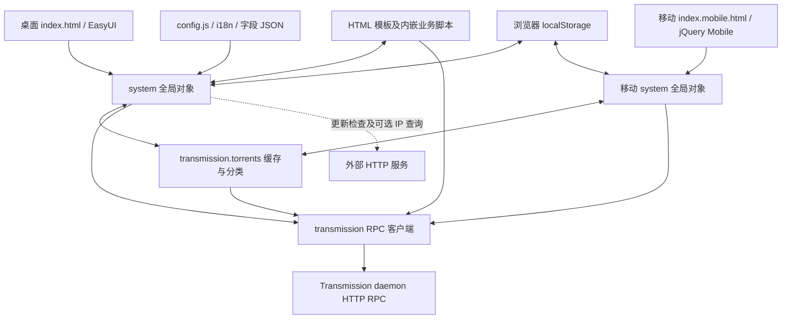

# transmission-web-ui 工程全貌与重构分析基线

> 调研日期：2026-11-15（Asia/Shanghai）
> 仓库：`nimbusking/transmission-web-ui`；分析基线：`dd33182`（`init`）。
> 本文用于后续架构分析和重构设计；两轮分析仅更新本文；没有修改业务代码或操作真实 Transmission 数据。第二轮增加了以替身隔离网络与系统写操作的函数级验证。

阅读导航：第 1–15 节是工程概览；本轮重点在以下部分。

- [八条路径的调用级深读](#deep-reading)：启动、RPC、缓存、桌面、模板、工作流、移动、安装器。
- [问题台账与验证输入](#behavior-evidence)：B01–B12、I01–I04、C01–C12。
- [模块边界与迁移顺序](#refactor-contracts)：区分需要保留的语义和需要修正的实现。
- [本轮验证边界与修订](#round-two-scope)：明确模拟结果和真实环境验证的区别。

## 1. 核心结论

这是一个直接部署到 Transmission Web 目录中的**静态管理界面**，继承自 `ronggang/transmission-web-control`。它不包含下载引擎、独立后端、数据库或自己的用户认证系统。浏览器通过 Transmission HTTP RPC 操作实际任务和服务配置。

当前结构是“全局 JavaScript 对象 + jQuery UI 组件 + 动态 HTML 模板 + 浏览器 localStorage”。桌面版用 EasyUI，移动版用 jQuery Mobile，两套页面、控制逻辑和交互结构各自维护，共享底层 RPC 与 torrent 数据处理代码。

后续重构最需要先解决的五件事：

1. **确认运行代码的唯一来源。** 两个入口实际加载 `script/min/*.min.js`，而非同目录的可读源码；已经确认 `system.js` 与 `system.min.js` 存在功能差异，不只是压缩格式差异。
2. **先建立行为基线，再拆分模块。** 大量业务逻辑藏在 HTML 模板中；仅重写 `system.js` 会遗漏文件优先级、配置导入、批量改目录等功能。
3. **修复部署链路。** 安装脚本仍从原上游/Gitee 仓库下载安装内容；路径选择、环境变量、错误处理和回滚存在明确缺口。
4. **分离 RPC、数据状态和 DOM。** 当前网络失败可能让刷新锁不释放，数据聚合与界面更新强耦合，很难独立测试。
5. **保留本地数据迁移能力。** 标签、标签与种子的映射、目录字典、列布局等保存在浏览器，而非 Transmission 服务端；不能在重构时当成可丢弃的缓存。

## 2. 调研范围与证据边界

### 2.1 已检查的内容

- 仓库目录和 Git 基线、全部本地 Markdown 说明、根许可证。
- 桌面和移动 HTML 入口、加载依赖、核心业务脚本、配置与插件入口。
- 模板功能、内嵌脚本、表格字段定义、语言清单与语言 JSON 结构。
- 三份 release 安装脚本的完整逻辑及逐份差异。
- 静态资源分布、依赖头部版本信息、全部 JS/内嵌脚本的解析检查。
- 可读源码与压缩运行文件的全局对象接口对照，并进一步核对已发现的 IP 查询实现差异。

### 2.2 未验证的内容

- 没有连接真实 Transmission daemon，也没有进行浏览器端到端回归、真实下载/删除/移动数据操作。已执行的模拟验证见第 18、20 节。
- 没有执行真实安装、修改系统权限或实际下载远程 release 包；第二轮仅隔离调用提取的安装器函数。
- 未在线核验 README 中外部官网、Wiki、GitHub/Gitee 发布接口的当前状态；本文对这些地址只分析其在本地代码中的用途。
- 未对所有第三方库逐行审计，未完成全部 source/min 文件的语义等价证明。
- 当前 Transmission 各版本、NAS 套件与浏览器支持范围，需要后续单独建立验证矩阵；不能从历史代码中的版本分支直接推导“已兼容”。

文中“已确认”指能由仓库代码、静态检查或已注明边界的隔离验证证明；“风险/待验证”指已看到可疑实现，但尚未在实际服务环境确认表现或影响范围。

## 3. 项目身份、文档和版本现状

| 项目 | 仓库实际情况 | 后续意义 |
| --- | --- | --- |
| README | 说明重启原暂停维护项目，强调只是 WebUI；包含 DSM 7 权限命令 | 缺少完整开发、构建、部署、测试指南 |
| 中文 CHANGELOG | 最新条目为 2018-03-30 `v1.5.1-update2` | 不能代表现有源码全部功能 |
| 英文 CHANGELOG | 同样到 `v1.5.1-update2`，历史信息比中文少 | 不能作为完整行为规格 |
| 桌面版代码版本 | `1.6.1`，`codeupdate: 20200913` | 版本信息散落在业务代码中 |
| 移动版代码版本 | `1.6.0 beta`，`codeupdate: 20180906` | 两端演进不同步 |
| HTML 缓存参数 | 桌面多为 `20200914/20201001`；移动多为 `20180906` 等 | 手工日期与代码版本不是统一的发布标识 |
| 安装器版本 | 三份脚本均为 `1.2.5` | 与 UI 版本独立 |
| Git 历史 | 本地可见 `dd33182 init`、`d1f7a9f Initial commit` | 原上游演进历史不在当前提交链中 |
| 根 LICENSE | MIT，Copyright 2026 NimbusK | 不能据此把所有内置第三方资源都视为相同许可 |

README 中 DSM 7 示例涉及 `/etc/group`、`chown` 和递归 `chmod 774`。其中 `sed` 是在匹配行末直接附加用户名，不负责成员分隔符、去重及幂等；硬编码 `web/` 又与脚本按版本选择 `public_html/` 的行为不同。应将其视为历史操作说明，在确认实际套件和目录后重新整理，不能直接作为通用安装规范。

关于页面还保留原作者版权、原上游主页、Wiki、发布页、捐赠页和 PT 插件链接。更新提示同样指向原上游，而不是当前 fork。

## 4. 目录与规模

```text
transmission-web-ui/
├── README.md
├── CHANGELOG.md / CHANGELOG-EN.md
├── LICENSE
├── release/
│   ├── install-tr-control.sh          # 英文提示，GitHub 源
│   ├── install-tr-control-cn.sh       # 中文提示，GitHub 源
│   └── install-tr-control-gitee.sh    # 中文提示，Gitee 源
└── src/                              # 直接部署的静态文件根目录
    ├── index.html                    # 桌面入口
    ├── index.mobile.html             # 移动入口
    ├── favicon.ico
    └── tr-web-control/
        ├── config.js                 # 桌面默认配置覆盖与主题列表
        ├── plugin.js                 # 两个内置扩展的分发入口
        ├── i18n.json                 # 可选语言清单
        ├── i18n/                     # 16 份语言 JSON
        ├── template/                 # HTML 业务模板及表格字段 JSON
        ├── script/
        │   ├── transmission.js       # RPC 请求与基础操作
        │   ├── transmission.torrents.js # torrent 缓存、聚合、查询
        │   ├── system.js             # 桌面控制器
        │   ├── system.mobile.js      # 移动控制器
        │   ├── public.js             # 格式化、原型扩展、文件辅助
        │   ├── FileSaver.js
        │   ├── min/                  # 页面实际使用的压缩文件
        │   ├── jquery/               # jQuery / Mobile / form / Base64 等
        │   ├── easyui/               # EasyUI、语言、主题、列拖动插件
        │   ├── plugins/              # webui-popover
        │   └── other/                # UAParser、clipboard
        └── style/                    # 桌面/移动样式、字体、图标、国旗
```

本次统计 `src` 共 **810 个文件、3,748,950 字节（约 3.58 MiB）**，其中 53 个 JS、22 个 JSON、19 个 HTML、27 个 CSS、648 个 PNG、35 个 GIF，另有字体、SVG 和 ICO。HTML 数量包含 iconfont 示例，不全是业务页面。

主要文件按 `wc -l` 统计：

| 文件/目录 | 行数 | 阅读重点 |
| --- | ---: | --- |
| `script/system.js` | 3579 | 桌面全部 UI 协调、配置、刷新与详情 |
| `script/system.mobile.js` | 777 | 移动状态、分页、批量操作 |
| `script/transmission.torrents.js` | 540 | 全量/增量合并、分类、Tracker 聚合 |
| `script/transmission.js` | 342 | Session ID、HTTP、RPC 封装 |
| `script/public.js` | 493 | 全局辅助函数、原型扩展 |
| `template/dialog-system-config.html` | 1201 | daemon 参数与本地参数混合编辑 |
| `template/torrent-attribute.html` | 671 | 文件、Tracker、Peer、单任务配置 |
| `template/dialog-auto-match-data-folder.html` | 548 | 多步骤 RPC 工作流 |
| `template/` 全部文件 | 4389 | 业务代码不能忽略这一部分 |
| 三份安装脚本 | 547 / 547 / 548 | 几乎重复维护 |

仓库未提供 `package.json`、依赖锁文件、构建脚本、测试目录、CI 工作流、容器开发配置或 source map。当前 `src/` 同时承担源码存储和发布目录职责。

## 5. 运行架构与模块边界



图中两个 `system` 对象位于不同页面，不能同时加载后期待互相协作；两者使用同一个全局变量名。

### 5.1 RPC 层：`transmission.js`

- 默认端点为相对 URL `../rpc`，`init()` 最终将 `fullpath` 设为 `rpcpath`。
- `host`、`port: 9091`、`path: /transmission/rpc` 虽存在，拼接绝对地址的代码已被注释；它们不是当前有效的多服务器配置界面。
- 初始化发送 POST，期待 HTTP 409 响应中的 `X-Transmission-Session-Id`，然后进入初始化回调。
- 后续请求发送 `{ method, arguments, tag }` JSON，并带 Session ID 请求头。
- 请求遇到 409 时更新 Session ID 并重发；其他 HTTP 错误交给全局 `on.postError`。
- 提供 session 查询、URL/文件添加、删除、空间查询、blocklist 更新、重命名等封装；不少模板也直接调用通用 `exec()`。
- 若设置 username/password，会构造 Basic Authorization，但正常入口未提供独立登录流程，认证主要依靠 daemon/部署环境。
- `session-close` 有底层封装，不能由此认为存在完整的前端登录/退出系统。

### 5.2 数据层：`transmission.torrents.js`

关键状态：

| 状态 | 用途 |
| --- | --- |
| `all` | 按 torrent ID 索引的合并结果 |
| `datas` | 收到并保留的任务数据；与 `all` 存在重叠和共享对象 |
| `recently` / `removed` | 当前增量响应与删除 ID |
| `newIds` | 增量发现的新任务，需要补齐基础字段 |
| `status` | 以 Transmission 状态码组织的分组 |
| `actively` / `error` / `warning` | 自定义活动、错误与 Tracker 警告视图 |
| `folders` / `transmission.trackers` | 路径层级、Tracker 聚合 |
| `downloadDirs` | 已遇到的下载目录列表，不是服务端文件系统目录枚举 |

`getallids()` 先获取完整基础字段，之后通常发送 `ids: "recently-active"` 和精简字段。`splitid()` 合并旧值、移除删除项、计算状态和目录/Tracker 分组，再为新任务追加信息请求；代码意图是补齐基础信息，但字段选择有缺陷，详见第二轮 B02。

注意业务语义：

- `actively` 按上传或下载速率大于 0 判断，不等同于 RPC `recently-active` 查询语义。
- `remainingTime` 自行按剩余字节/下载速度计算，以毫秒保存；未知值用约 100 年的数值表示。
- 上传、下载历史都为 0 时将分享率设成 `-1`，显示层用 `∞` 展示。
- Tracker 名称通过去掉 `www/tracker/announce` 前缀等规则归组，不是严格的站点身份模型。
- Tracker 数量大于 5 被当成 BT 类型的启发式条件；它不能准确判断 PT/BT。
- `puased`、`getTarckers` 等拼写已成为现存字段，重命名需检查调用方。

### 5.3 桌面控制器：`system.js`

职责涵盖启动、语言、主题、导航树、datagrid、工具栏、右键菜单、快捷选择、上传拖放、轮询、详情、配置、标签、弹窗、更新提示和 IP 查询。它既持有数据引用，又直接生成 HTML 并操作 DOM，是最主要的耦合中心。

关键入口按当前源码定位：

| 函数 | 大约行号 | 用途 |
| --- | ---: | --- |
| `init` / `initdata` | 148 / 211 | 加载本地状态、构建 UI、连接服务 |
| `initTorrentTable` | 728 | 字段模板、列配置、选择和排序事件 |
| `connect` | 1594 | 注册 RPC 事件并初始化连接 |
| `reloadTorrentBaseInfos` | 1664 | 刷新锁、基础/增量数据查询 |
| `resetTorrentInfos` | 1694 | 更新导航及列表 |
| `loadTorrentToList` | 2099 | 分类选择、过滤、排序与分页 |
| `getTorrentInfos` | 2616 | 选中任务的详情查询 |
| `readConfig` / `saveConfig` | 3183 / 3196 | 本地配置读写 |
| `checkUpdate` | 3235 | 查询原上游 release 元信息 |
| `openDialogFromTemplate` | 3300 | 动态加载及复用 HTML 模板 |

行号是本次快照导航，后续修改后应以函数名搜索。

### 5.4 模板、插件和公共工具

模板不是纯展示文本：HTML 中包含立即执行函数、事件绑定和 RPC 请求，使用 `dialog.data(...)` 接收调用参数。`openDialogFromTemplate()` 动态获取模板并保存到 `system.templates`，同时支持 EasyUI dialog 和 popover。

`plugin.js` 只是固定 `switch` 分发器，目前两个分支：批量替换 Tracker、自动匹配数据目录。它没有动态插件发现、隔离、权限或标准生命周期。

`public.js` 直接扩展 `String.prototype`、`Number.prototype`，提供日期、字节、速度、时间、排序、分片处理、文件读取/导出等全局函数。工具函数与全局 `system`、jQuery 存在隐式依赖，不是独立的纯工具库。

## 6. 页面启动、刷新和用户操作链路

### 6.1 桌面启动

1. HTML 按顺序加载 jQuery、form/json2/Base64、EasyUI、列拖动/popover，再加载压缩业务文件。
2. 加载 `config.js` 覆盖内置默认值、加载 `plugin.js`。
3. UAParser 判断设备，非桌面设备通常跳转移动页；`?devicetype=computer` 可强制桌面模式。
4. DOM ready 后并行请求英文语言包与 `i18n.json`；语言清单返回时触发 `system.init()`。
5. 读取 localStorage、解析语言、加载所选语言包和 EasyUI locale，构建界面与表格。
6. `transmission.init()` 获取 Session ID；随后读取 session 参数和 session 统计，再进入 torrent 查询与界面更新链。
7. 同时发起上游版本检查，它只提供更新提示/链接，不是在浏览器内执行 shell 更新。

**初始化风险：** 英文基线包与语言清单分别异步加载，没有共同完成屏障；所选语言包在英文基线尚未就绪时合并，可能失去缺失字段回退。语言 JSON 请求失败也缺少统一的可恢复启动错误状态。

### 6.2 周期刷新

- 桌面默认 5 秒，`config.js` 默认每页 200 条，支持关闭分页和最多 5000 条的选项。
- 使用 `setTimeout` 延续刷新，不是 WebSocket；`reloading` 用于防止部分重复刷新。
- 获取增量数据后会重新遍历缓存，重建分类、Tracker、目录和统计，再更新当前页；所以分页并不意味着服务端只查询一页。
- 详情面板展开时才请求选中任务详情；`infoIsLoading`、`moreInfosTag` 控制请求与首次补齐字段。
- popover 打开时会推迟刷新；多个 UI 状态参与刷新调度，后续应把调度策略单独抽离。
- 新任务补齐请求、详情请求、session 请求之间仍存在异步交错；单个 `reloading` 不是完整的请求取消/顺序控制方案。

### 6.3 添加、删除与修改任务

- URL/magnet/40 位 hash：`addTorrentFromUrl()`；纯 hash 被转成 magnet。多 URL 使用递归回调逐个提交。
- 本地 `.torrent`：FileReader 读取为 Data URL，提取 Base64，通过 `torrent-add.metainfo` 提交；拖放入口复用相关逻辑。
- 添加模板仍保留通过 `../upload?paused=...` 和 `jquery.form.ajaxSubmit()` 上传的兼容路径。重构代理配置时不能只看到 `../rpc`。
- 删除：`torrent-remove`，通过 `delete-local-data` 区分仅移除任务和删除数据。
- 开始/停止/校验/重新 announce、队列移动：由工具栏或菜单映射到 RPC。
- 改目录：`torrent-set-location`，`move` 区分移动数据与只更换定位目录，可追加校验。
- 重命名：`torrent-rename-path`；不是只改本地列表标题。
- 文件是否下载/优先级、Tracker 增删改、上传下载与做种限制：通过 `torrent-set`。

## 7. 功能地图与模板职责

| 功能域 | 主要位置 | 说明 |
| --- | --- | --- |
| 导航与任务列表 | `system.js`、`torrent-fields.json` | 状态、Tracker、目录、统计、标签、搜索、分页和列布局 |
| 任务详情 | `torrent-attribute.html` + 三份 attribute fields JSON | 基本属性、文件、Tracker、Peer、单任务配置 |
| 添加任务 | `dialog-torrent-add.html`、`dialog-torrent-addfile.html` | URL、文件、保存目录、自动启动、可选标签 |
| 删除任务 | `dialog-torrent-remove-confirm.html` | 显式选择是否删除本地数据 |
| 重命名 | `dialog-torrent-rename.html` | 提交 RPC 后刷新名称与详情缓存 |
| 改目录 | `dialog-torrent-changeDownloadDir.html` | 单任务/批量、移动数据、重新校验 |
| 批量限速配置 | `dialog-torrent-changeSpeedLimit.html` | 下载/上传限速、Peer 上限；分享率与空闲做种限制在详情配置页 |
| Tracker 编辑 | `dialog-torrent-attribute-add-tracker.html`、详情模板 | 增删改 Tracker |
| 批量替换 Tracker | `dialog-system-replaceTracker.html` | 遍历任务匹配地址并分组提交替换 |
| 自动匹配数据目录 | `dialog-auto-match-data-folder.html` | 试目录、校验、读进度，再决定下一步 |
| 目录字典 | `dialog-auto-match-data-folder-dictionary.html` | 保存用户输入的候选目录 |
| 系统配置 | `dialog-system-config.html` | daemon 参数、本地 UI、语言、导航、标签、IP 查询配置 |
| 配置导入/导出 | `dialog-import-config.html`、`dialog-export-config.html` | 系统/用户/目录/服务端参数的选择性迁移 |
| 标签 | `dialog-torrent-setLabels.html`、`config-user-labels-fields.json` | 本地标签定义与 torrent hash 映射 |
| 关于 | `dialog-about.html` | 版本与历史项目链接 |

### 7.1 自动匹配目录的真实含义

它不是浏览器扫描服务器磁盘，也不是 daemon 提供的“寻找文件”专用接口。实现基于用户目录字典，筛选暂停且完成度为 0 的任务，对候选目录执行：

```text
set-location(move=false) → torrent-verify → 等待配置间隔 → torrent-get → 判断结果
```

界面模式 1 按任务逐个尝试目录；模式 2 当前调用 `execMatchDataFolderMode3()`，按目录批量处理任务。文件还保留 `execMatchDataFolderMode2()` 旧实现。

固定等待时间并不保证校验结束，`percentDone != 0` 也不等于文件全部匹配成功。取消依赖 `isworking` 等局部变量，不能撤销已送到 daemon 的修改；失败或中止时原目录恢复没有完整事务机制。这一功能应作为独立工作流分析，优先设计可取消、可观察、可恢复的状态机。

### 7.2 移动端范围

移动端以分类首页、任务列表、批量开始/暂停/删除/校验、URL 添加、目录选择和刷新设置为主，系统配置入口在页面中隐藏。没有加载桌面 `config.js`、`plugin.js`、EasyUI 或 FileSaver，不能假设桌面全部功能在移动端都有。

两端共享 RPC 和 torrent 层，也共享 `.system` localStorage 键，但移动端默认配置较少、采用浅合并，桌面采用深合并。重构时要明确哪些设置共享，哪些属于不同界面的独立偏好。

## 8. 配置、持久化与数据归属

### 8.1 桌面配置优先级

```text
system.js 内置默认值
    → config.js 的 $.extend 覆盖
    → readConfig() 深合并 localStorage
    → 当前 UI 修改并 saveConfig()
```

因此仅修改 `config.js` 不一定影响已有用户：旧的 localStorage 可能覆盖新默认值。移动端没有第二步。

### 8.2 存储分层

| 数据 | 位置 | 生命周期/迁移重点 |
| --- | --- | --- |
| 下载任务、文件状态、速度、Tracker | Transmission daemon | RPC 是事实来源 |
| 服务端全局参数 | `session-get/session-set` | UI 修改实际 daemon 行为 |
| 当前任务缓存与选中状态 | JS 内存 | 可重建，但需处理异步一致性 |
| UI 配置、主题、导航、标签 | `transmission-web-control.system` | 两端共用，同 origin 下持久化 |
| 列布局与排序等用户设置 | `transmission-web-control` | 与主配置独立存储 |
| 目录字典 | `dictionary.folders` | 换行分隔字符串；默认可能为 null/undefined |
| 自动匹配模式与间隔 | `auto-match-data-folder-work-mode` / `auto-match-data-folder-time-interval` | 单独的非命名空间化键 |
| 导出文件 | `tr-web-control-config.json` | `configVersion: 1`，包含所选配置类别 |

标签定义在 `config.labels`；任务标签映射在 `config.labelMaps[hashString]`。这是 **WebUI 本地标签**，本仓库没有把它作为 Transmission 原生标签字段同步。清除浏览器存储、换浏览器或换 origin 都可能让用户看不到原标签。

导出可以包含 `system`、`user`、`dictionary-folders`、`server`，服务端部分从 session 信息中排除少量只读字段。导入服务端参数会真正调用 `session-set`，并非只修改界面。当前 schema 校验、版本迁移和字段白名单还不完整。

### 8.3 持久化需要关注的现有边界

- JSON.parse 和 localStorage 访问缺少统一异常保护：损坏内容、禁用存储或容量问题可能中断页面逻辑。
- 存储键没有按 RPC 地址或实例区分；同 origin 托管多个 daemon 时有配置混用风险。
- 未配置目录字典时，导出模板直接调用 `system.dictionary.folders.split("\n")`，存在空值异常路径。
- “恢复界面默认设置”直接清空 `system.config` 和 `system.userConfig` 后保存，标签定义和映射也属于被清空的主配置；后续需要明确恢复默认的范围。
- 部分 UI 本地参数保存依赖系统设置事件的控制分支；当 daemon 参数、语言和目录字典均未变时可能提前返回，需验证“仅改本地设置”是否真正持久化。

## 9. 依赖、样式、语言和运行资产

### 9.1 随仓库提交的依赖

| 依赖 | 本地证据/用途 |
| --- | --- |
| jQuery 1.12.4 | 两端核心 DOM、Ajax、插件机制 |
| EasyUI 1.5.4.5 | 文件头可见此版本；桌面布局、树、表格、对话框 |
| jQuery Mobile 1.4.5 | 移动入口实际引用；另保留 1.3.2 文件 |
| jquery.form | 旧上传路径 |
| Base64 / json2 | 字符串编码和历史 JSON 支持 |
| FileSaver | 桌面配置等文件导出 |
| clipboard / UAParser | 剪贴板、设备检测 |
| webui-popover | 标签/提示等浮层 |
| jquery.datagrid.drophead | 列头拖动 |

这些依赖直接保存在仓库，没有包管理器记录、锁文件和自动升级约束。源码还混用了 `let`、`const`、箭头函数、`replaceAll` 等写法，不能因为 jQuery 较老就认为整个页面兼容老浏览器。

根目录 MIT 与 EasyUI 文件头的 freeware license 声明不同；后续发布需整理第三方来源和声明。这里只记录本地文本，不对外部许可证条款或适用范围作结论。

### 9.2 样式资源

- 桌面 `before-easyui.css`、`base.css`、EasyUI theme、图标字体/自定义图标层叠组合。
- 移动使用 `base.mobile.css` 和 jQuery Mobile 样式，结构独立。
- `config.js` 列出 15 种主题，与本地 15 份主题 CSS 对应；某些主题值使用 `主题名;logo-white.png` 编码附加 logo 信息。
- 国旗、传统位图图标、iconfont、旧样式并存；不能只按文件名推断未使用资源后直接删除。

### 9.3 多语言

语言清单共 16 种。程序读取浏览器/用户语言、归一化语言代码，加载 JSON，并把 `system-lang`、`system-tip-lang` 中的表达式通过 `eval()` 解析后写入 DOM。桌面另外加载 EasyUI locale，失败时尝试英文 locale。

本次 JSON 叶子键对照以英文 374 个键为基线：

| 语言 | 缺少英文键数量 | 多出英文基线的键数量 |
| --- | ---: | ---: |
| en / de / pl / ru | 0 | 0 |
| zh_CN / zh_TW | 1 | 3 |
| es | 13 | 0 |
| uk | 16 | 0 |
| pt_BR | 28 | 0 |
| it | 33 | 0 |
| fr / hu / ko / nl / pt_PT / ro | 40 | 0 |

这只是结构覆盖率，不是翻译质量评价；运行时原本依赖英文基线补齐，因此启动顺序问题值得优先修正。

### 9.4 已确认的 source/min 漂移

对四组核心全局对象在屏蔽 DOM ready 的 Node VM 中做接口对照，发现：

- `system.js` 有 `ipdetail` 状态和 `expandIpInfoUrl()`；`system.min.js` 没有。
- 可读源码支持 `ipInfoFlagUrl`、`ipInfoDetailUrl`，压缩版 Peer 查询只使用 `ipInfoToken` 与固定 ipinfo 地址。
- `config.js`、设置模板已出现自定义 IP URL 配置，模板测试按钮直接调用缺失的 `system.expandIpInfoUrl()`。
- 源码还对 Peer IP 的 CSS 类名字符做了处理，压缩版保留直接拼接 IP 的旧逻辑。

所以仅修改可读源码不会自动进入实际页面，且现有发布目录已经混用了不同阶段的代码。其他三组对象顶层键一致，**不代表函数实现全部等价**。建立构建流程后还需要对 source/min 行为做完整回归。

## 10. release 安装脚本详解

### 10.1 三个版本的区别

| 脚本 | 包源和版本 API | 其他差异 |
| --- | --- | --- |
| `install-tr-control.sh` | GitHub `ronggang/transmission-web-control` | 英文提示 |
| `install-tr-control-cn.sh` | 同上 | 与英文版主要差别为提示文本，安装逻辑一致 |
| `install-tr-control-gitee.sh` | Gitee `culturist/transmission-web-control` | 中文提示；不同的 API 文本解析；带 v 的版本不去前缀以适配解压目录 |

**三者都没有下载当前 `nimbusking/transmission-web-ui` 仓库。** release 目录是安装器集合，不是当前项目已经构建出的 UI 发布包。

### 10.2 调用和菜单

以下仅解释脚本现有参数语义，不是本次执行记录：

```bash
bash release/install-tr-control.sh
bash release/install-tr-control.sh /usr/share/transmission
bash release/install-tr-control.sh auto /usr/share/transmission
```

- 普通第一个参数为根目录，脚本通常追加 `/web`；并不是直接传最终 Web 目录。
- 第一个参数为 `auto` 时自动查询最新 release，第二个参数才是根目录。
- 非 root 会读用户输入；只有明确输入 n/N 才退出，因此 auto 并非所有情况下完全非交互。
- Bash 语法包括 `[[ ]]`、子串和替换；历史注释中的 `sh install...` 不应视为可移植 POSIX sh 用法。

| 菜单 | 行为 |
| --- | --- |
| 1 | 查询 latest release 后安装 |
| 2 | 输入指定版本，可用于降级 |
| 3 | 尝试恢复 `index.original.html` |
| 4 | 删除本地脚本后重新下载脚本 |
| 5 | 检查 transmission-daemon，按输入尝试 service start |
| 6 | 输入包含 web 子目录的父目录，再回到菜单 |
| 9 | 使用 master 源码包 |
| 0/其他 | 退出 |

### 10.3 主调用链

```text
启动变量与参数处理
  → 用户身份提示
  → 自动安装 / 菜单
  → getLatestReleases（最新版本场景）
  → main
      → begin
      → initValues
          → getTransmissionPath
          → 设置包名和下载 URL
          → 必要时 findWebFolder
      → install
          → download
          → unpack
          → cp
          → setPermissions
          → installed
      → clear
```

`checkTransmissionDaemon()` 是独立菜单功能，不是每次安装前都执行的守卫。

### 10.4 目录识别顺序与平台假设

1. 优先使用传入的 `ROOT_FOLDER`；未提供时运行 `getTransmissionPath()`。
2. Fedora/Debian/OpenWrt 尝试 `/usr/share/transmission`，FreeBSD 尝试 `/usr/local/share/transmission`。
3. Synology 尝试 `/var/packages/transmission/target/share/transmission`；若能执行 `transmission-remote -V`，主版本首字符为 2 时选择 `web`，其他值选择 `public_html`。
4. 默认目录不存在时，从进程命令行推断安装位置，把 `bin/transmission-daemon` 替换成 `share/transmission`。
5. `initValues()` 只要发现根目录存在，即设置 `WEB_FOLDER=ROOT_FOLDER/HTML_FOLDER_NAME`、`INSTALL_TYPE=3`、`SKIP_SEARCH=1`。
6. 仅当未跳过搜索时，`findWebFolder()` 才检查 `TRANSMISSION_WEB_HOME`；否则搜索 `/usr /etc /home /root ./` 中形似 `transmission/web` 的目录。

因此环境变量没有实现“显式设置就优先”的语义。多个匹配目录会一起塞入一个字符串，脚本没有让用户选择实例；平台命令还依赖特定 `ps`、`sed -r` 等行为。

### 10.5 包格式、备份和权限

- 默认临时目录固定为 `/tmp/tr-web-control`。
- master/40 字符版本使用相应 `.tar.gz`；普通版本追加 v，GitHub 分支对已有 v 前缀的 VERSION 做裁剪，以拼接解压目录名。
- 非空 VERSION 分支假设解压得到 `transmission-web-control-$VERSION/src/`，把其中内容递归复制到 `WEB_FOLDER`。
- 空 VERSION 分支仍按旧式“包直接含静态资源”的结构处理，与当前默认 master 源码归档布局不一致。
- `unpack()` 在解压后备份原 `index.html` 为 `index.original.html`（仅当备份尚不存在），再删除旧 `tr-web-control/`。
- 权限设置对目录执行 `chmod o+rx`，对文件执行 `chmod o+r`；未设定 owner，部分路径分支覆盖的是整个 ROOT_FOLDER。
- 恢复操作删除新 UI 目录、favicon 和两个入口，再把备份首页改回；它不是完整的原版目录快照恢复，也不恢复权限。

### 10.6 安装器问题清单

| 优先级 | 已观察的代码行为 | 影响及需验证点 |
| --- | --- | --- |
| P0 | `findWebFolder()` 的环境变量分支设置类型 2，却没有赋值 `WEB_FOLDER` | 非空 VERSION 分支会向 `"$WEB_FOLDER/"` 即 `/` 复制；相关备份路径也可能变成根目录路径。此路径由静态控制流确认，未执行 |
| P0 | 普通系统根目录存在就跳过环境变量分支 | 设置 `TRANSMISSION_WEB_HOME` 仍可能覆盖默认安装目录 |
| P0 | `unpack`/`cp`/权限操作失败没有统一中止；旧目录删除早于新文件复制成功 | 解压或复制失败仍可打印安装成功，且可能破坏原 UI |
| P1 | 包与脚本下载使用 `--no-check-certificate`，没有摘要/签名校验 | 不能确认下载内容完整性及来源绑定 |
| P1 | latest API 解析依赖 grep/sed/cut，未校验 VERSION 非空 | 失败后进入旧包布局分支，可能出现目录嵌套或错误安装 |
| P1 | Gitee 带 v 与不带 v 的手工输入处理不对称 | 输入 `1.x` 时下载名有 v、预期解压目录可能无 v，需要归档夹具验证 |
| P1 | 固定临时目录，无锁、无安全独立工作目录和退出清理 trap | 并发安装、遗留内容及异常退出缺乏隔离 |
| P1 | 目标路径只检查根目录存在，没有完整验证目标、归档结构与可写性 | 目标 Web 子目录不存在时，版本分支复制可能失败 |
| P1 | 更新仅备份 index，删除旧业务目录 | 自定义 config.js 等文件没有完整保留/迁移策略 |
| P1 | 恢复原版仅处理少数文件 | favicon 等原资产、原权限不保证恢复 |
| P2 | latest 查询允许 curl，但包下载固定用 wget | 仅有 curl 的系统仍不能完成安装 |
| P2 | `$SCRIPT_NAME` 直接用 `$0` 拼 URL，先删除旧脚本 | 以相对/绝对路径执行时 URL 含路径；下载失败后旧脚本已丢失 |
| P2 | `[ $TRANSMISSION_WEB_HOME ]` 未加引号，部分路径命令也未统一引用 | 带空格路径或多结果搜索可能异常 |
| P2 | 三套重复脚本、硬编码仓库与平台推断 | 修复容易漏同步，fork 发布无法自然接入 |

P0 表示应在使用或重做发布链路前优先处理，不代表本次发生了真实系统破坏。

## 11. 重构风险登记

| 优先级 | 事项 | 证据与边界 | 建议的验证/拆分方向 |
| --- | --- | --- | --- |
| P0 | source/min 功能漂移 | 已核实 IP 查询接口差异 | 先建立单一源码构建和运行产物一致性检查 |
| P0 | 安装器路径及失败处理 | 见上一节静态控制流 | 用临时目录和伪下载器测试，禁止真实系统回归 |
| P1 | 网络失败卡住刷新/操作 | `reloading` 在成功回调释放，postError 基本空实现 | mock 超时、401/403、500、断网，统一 finally 与重试 |
| P1 | 初始化和 409 恢复不完整 | 握手只处理特定 409；exec 的 409 重试没有次数上限 | 显式连接状态、限次重试、错误展示 |
| P1 | HTML 插值缺少转义 | `getTorrentNameBar()` 拼接 name/path/error 到标签与 title；其他位置直接 `.html()` | 以恶意名称/Tracker 信息夹具检查，改为安全文本节点；不将静态风险描述为已完成利用验证 |
| P1 | 本地数据丢失/不兼容 | 标签、字典等在 localStorage，导入无完整 schema | 版本化 schema、备份、迁移测试及实例隔离 |
| P1 | 自动匹配目录不可恢复 | 修改目录并校验，固定等待后判断 | 单独的可取消任务模型、原目录记录、明确完成条件 |
| P1 | 移动删除参数类型 | 页面传 `$('#remove-data').val()`，控制器直接写到 `delete-local-data` | 当前发出字符串而非布尔，服务端实际处理需联调；对破坏性参数做类型约束 |
| P2 | 语言初始化竞态 | 英文包与清单并行，英文回退未等待 | 统一启动 Promise 与缺失语言测试 |
| P2 | Tracker 替换索引可疑 | 批量替换使用数组下标 n，单项编辑使用 `tracker.id` | 构造 id 不等于数组位置的夹具验证 |
| P2 | 多份缓存与重新聚合成本 | all/datas/recently 共享可变状态，每轮全缓存分类 | 规范化 store、纯 selectors、可测合并逻辑 |
| P2 | 浏览器状态绑定组件内部 | DOM data、datagrid 选择状态、全局对象共同决定行为 | 将选择、筛选和分页移出组件实例 |
| P2 | 无输入错误边界 | 文件过滤直接构造 RegExp，配置直接 JSON.parse | 非法正则、损坏配置、空字典等回归 |
| P2 | 模板执行和 eval | 动态内嵌脚本、语言表达式 eval、内联事件 | 分离模板与控制器，使用显式字典访问 |
| P2 | 外部请求依赖 | 默认上游更新检查；开启 IP 查询后发送 Peer IP | 明确外部服务开关、失败处理与可替换适配器 |

还应单独检查空列表首次加载、任务运行中被其他客户端删除、重连后 ID/缓存有效性、无 tracker 的 magnet 阶段和高任务量下的响应时间。

## 12. 开发与部署的现状理解

当前没有 `npm install/dev/build/test` 约定。`src/` 应当作为完整静态目录部署，且相对 `../rpc`（以及保留的 `../upload`）必须映射到正确 Transmission 服务。

用任意静态 HTTP 服务只能检查页面资源加载，不能自动获得真实 RPC；直接以 file:// 打开也不能代表部署环境。后续开发环境应选定以下一种可控方式：

- 用临时的静态服务配同源 RPC 代理，连接专用测试 daemon。
- 用契约化 mock 提供 session/torrent 响应，先覆盖纯前端行为。
- 在测试 daemon 中配置独立 Web 资源目录，保留可回退的原版资产。

实际选择应取决于目标部署方式；本次不新增框架或开发服务器，也不替用户选择最低 Transmission 版本。

现有代码有 `rpc-version >= 15` 时使用 `free-space` 的兼容分支，但这只是一个能力判断，不能替代所有 RPC 方法/字段的兼容矩阵。

## 13. 建议的目标架构和渐进路线

### 13.1 建议模块边界

保持静态 UI 可直接部署这一特性，先建立下列逻辑边界；目录名仅作为设计建议，并非本次已实现：

```text
app/             启动、依赖装配、路由/视图切换
rpc/             Session ID、HTTP、错误、重试、能力检测
models/          session/torrent/peer/tracker 数据定义
store/           规范化任务缓存、选择、筛选和分页状态
selectors/       状态分类、Tracker/目录/标签聚合、统计
features/        添加、详情、文件操作、配置、标签等功能
workflows/       批量改目录、自动匹配等多步骤任务
storage/         localStorage schema、导入导出、迁移
ui/              可替换的桌面/移动表现组件
i18n/            语言加载、键检查、格式化
integrations/    IP 查询、更新检查等外部接口
release/         可验证的打包、安装、升级与回滚
```

数据流应变为：用户动作 → 功能命令 → RPC → store 更新 → 派生视图 → UI。模板不应独立发出 RPC，选择状态不应只保存在 datagrid 内部。

### 13.2 阶段安排与完成条件

| 阶段 | 主要工作 | 完成条件 |
| --- | --- | --- |
| 0：固化基线 | 保存实际运行产物、修订功能清单、录制 RPC 夹具、确定支持矩阵 | 能复现当前主要功能及关键失败路径 |
| 1：打通构建与发布 | 统一 source/min 来源、版本和缓存标识；安装器目标校验、临时目录、备份回滚 | 一条可复现构建命令；失败安装不改变现有 UI；安装来源为当前项目 |
| 2：抽离 RPC 与 store | Promise/错误类型/重试边界、全量增量合并、纯聚合函数 | 可不加载 DOM 测试核心状态变化；断网后可恢复 |
| 3：抽离业务与存储 | 模板业务迁出、配置 schema、标签迁移、多步骤工作流 | 老配置可迁移；删除/移动/匹配有可验证的操作范围 |
| 4：替换表现层 | 统一两端功能模型，再评估响应式 UI 或保留独立视图 | 选定功能矩阵全部通过、旧 UI 可回退 |
| 5：清理与完善 | 清理已证明无用资源、移除遗留兼容路径、补文档与多语言 | 构建产物可追溯、资源来源明确、回归持续运行 |

不要一开始同时更换 UI 框架、RPC 实现、安装器格式和本地数据模型。先保证源码变更能可靠进入发布文件，再逐层替换，可以缩小每次回归的范围。

### 13.3 应保留的行为契约

- 区分 checked 多选和当前详情 selected，切换分类后不会对旧选择误操作。
- 删除数据选项必须显式布尔化，操作范围由固定 ID 快照决定。
- 下载目录、默认保存目录、移动数据与只定位数据是不同动作。
- 增量响应合并不能清空未返回的基础字段；removed 必须清掉所有派生视图引用。
- 以 hash 关联的本地标签要迁移，不能简单换用不稳定的会话 torrent ID。
- 页大小、排序、列显隐/顺序、主题、语言和目录字典需要明确的兼容策略。
- Tracker/目录/标签分组的现有 PT 使用体验要有回归样例。

## 14. 建议的验证矩阵

| 层次 | 应覆盖的场景 |
| --- | --- |
| RPC 单元/契约 | 初次 409、Session ID 失效、非 409 HTTP 错误、超时、业务 result 非 success、重复任务 |
| 数据处理 | 全量→增量→新任务补齐→删除；缺省字段；状态迁移；Tracker 聚合；目录树；搜索排序 |
| 存储 | 空/损坏/旧版本配置；语言字段缺失；标签迁移；字典为空；同 origin 多实例 |
| 桌面交互 | 列设置、选中与勾选、跨页/切分类、右键菜单、拖放、详情切换、刷新期间操作 |
| 移动交互 | 分类、分页、批量操作、布尔参数、添加 URL、刷新开关、桌面切换 |
| 多步骤任务 | 改目录失败、取消匹配、校验未完成、部分成功、任务被外部移除 |
| 安装器 | 显式路径/环境变量/多实例、缺依赖、空版本、404/损坏包、空间不足、复制失败、升级与回滚 |
| 性能 | 0/少量/大量任务、多个 Tracker、大文件列表、长时间轮询、网络抖动 |
| 安全边界 | 名称/错误/Tracker/导入内容的 HTML 转义，路径规范化，归档校验，破坏性操作参数 |

安装测试必须使用临时目录、模拟包和 stub 命令；真实 daemon 联调使用专门测试数据。应先选定需要保留的 Linux/NAS/容器平台，再验证其工具命令和目录布局。

## 15. 第一轮已执行的检查

| 检查 | 结果 | 能证明什么 |
| --- | --- | --- |
| 三份脚本 `bash -n` | 全部通过 | Bash 语法可解析；不证明安装正确 |
| `src` 全部 22 个 JSON | 全部解析成功 | JSON 语法有效 |
| 全部 53 个 JS | Node `vm.Script` 编译通过 | 当前 Node 解析器可解析；不证明目标浏览器支持 |
| HTML 中 18 段非空内嵌脚本 | 编译通过 | 内嵌 JS 无解析错误 |
| 两个入口的直接本地 src/href | 未发现缺失资源 | 不包含所有动态模板/CSS URL 的完整运行检查 |
| 16 份语言包叶子键对照 | 发现缺失键与额外键，见第 9 节 | 结构覆盖情况 |
| 四组 source/min 对象接口对照 | 桌面 system 存在差异 | 已明确部分运行产物过期；未证明其余实现等价 |
| ShellCheck | 环境未安装，未执行 | 不宣称完成 shell lint |
| 真实浏览器/daemon/安装流程 | 未执行 | 待后续专项验证 |

本次无必要启动完整测试环境，也没有新增镜像现有实现的测试代码；以上验证脚本为临时只读分析，未引入仓库依赖。

## 16. 深读导航（第二轮已完成）

1. `src/index.html` 和 `src/index.mobile.html`：先确认真正加载了哪些文件。
2. `script/transmission.js`：明确协议、会话握手与失败语义。
3. `script/transmission.torrents.js`：理解缓存合并和 PT 聚合规则。
4. `script/system.js` 的连接、刷新、列表、详情、配置段落，再回到事件绑定。
5. `template/torrent-attribute.html`、`dialog-system-config.html` 和添加/改目录模板：补齐实际写操作。
6. 自动匹配模板、批量替换 Tracker：分别建工作流与索引正确性分析。
7. `system.mobile.js` 与移动页内嵌脚本：检查两端差异及共享存储。
8. 三份 release 脚本：先规范目标目录和归档布局，再重做升级回滚。

上述八条路径的第二轮分析已记录在第 17 节；第 18 节给出问题编号、复现输入和验收断言，第 19 节明确模块边界与迁移顺序，第 20 节记录验证边界和对第一轮的修正。

---

<a id="deep-reading"></a>

## 17. 第二轮深读：按八条阅读路径建立行为契约

> 本节是在第一轮概览基础上的调用级分析。关注“当前怎么运行、哪些行为应保留、哪些缺陷不能照搬”。
>
> 证据级别：**代码确认**＝本地控制流可直接确定；**隔离复现**＝执行仓库函数、用 mock 替代网络/DOM/系统写操作后观察结果；**待联调**＝仍需真实浏览器、EasyUI 或 daemon 验证。隔离复现不是端到端测试。
>
> 下文业务路径以 `src/tr-web-control/` 为相对根目录；入口与安装器单独写明位置。源码行号用于定位分析基线，不代表压缩文件行号。

### 17.1 路径一：HTML 入口、加载时序与依赖装配

#### 17.1.1 三类加载机制同时存在

| 加载机制 | 当前入口 | 对重构的约束 |
| --- | --- | --- |
| 顺序 script 标签 | 两个 index 页面 | `public → transmission → transmission.torrents → system` 的全局依赖不能随意交换 |
| DOM ready 异步启动 | `system.js:3459` / `system.mobile.js:767` | 英文基线、语言清单、所选语言、locale、表格 schema 不是同一个 ready 条件 |
| UI 框架动态加载 | 桌面 HTML 的详情面板 `href`、`openDialogFromTemplate()` | 详情面板由 EasyUI 加载，普通弹窗由自定义加载器加载，生命周期不同 |

桌面 `config.js` 必须在 `system` 创建之后运行，因为它直接 `$.extend(system.config, ...)`；`plugin.js` 同样直接往 `system` 写属性。这解释了为何只替换入口导入方式也可能改变默认配置和插件初始化顺序。

`initdata()` 调用 `initTorrentTable()` 后立即 `connect()`，但前者只是发起字段 JSON 请求，不等待 datagrid 初始化完成。快速 RPC 与慢静态资源的组合可能让数据先于表格就绪。该竞态是代码确认，实际组件报错方式待联调。

详情 HTML 位于 EasyUI panel 的 `href`，具有自己的 `onLoad/isload` 状态；主控制器还会在展开时检查 `currentTorrentId`，必要时延迟 500ms 请求详情。新实现应以明确的组件挂载状态和请求状态替代固定延迟。

#### 17.1.2 启动依赖应显式化

建议把当前隐式依赖表达为：

```text
配置迁移完成 ─┐
英文基线就绪 ─┼→ 选定语言/回退完成 → UI shell 就绪
语言清单就绪 ─┘                         │
字段 schema 就绪 ──────────────────────┤
                                       └→ 连接 RPC → 首次完整快照 → ready
```

UI 可以先显示骨架，但写操作的“可用”应来自连接和能力状态，不能仅来自按钮已完成初始化。当前“添加”“开始所有”等按钮在连接完成前就能被启用，而 `exec()` 在未初始化时直接返回 false，不调用回调；操作有机会一直显示处理中。

#### 17.1.3 需要保留或澄清的入口行为

- `?lang=` 参与语言选择；`?devicetype=computer` 绕过桌面入口的自动移动跳转。
- 自动跳转直接设置 `index.mobile.html`，不保留原查询字符串；手工切换也有类似行为。
- `?local=` 被读取，但不是完整的远程服务器选择机制；连接代码仍使用同源相对 RPC。
- “原版 UI”链接是 `index.original.html`，该文件由安装过程产生，不由本仓库提供。
- 详情模板、JSON、locale 都必须能通过静态服务器访问；打包若重命名文件，需要同时处理这些动态路径。
- 内联菜单直接传 `queue-move-top/up/down/bottom` 给通用命令函数；这些命令不是 `torrent-` 前缀，不能用统一字符串拼接误改。

**拆分验收：** 在语言包/字段 JSON 延迟、RPC 很快、RPC 尚未连接时点击操作、强制桌面与移动切换四类场景中，界面状态明确且没有静默丢操作。

### 17.2 路径二：RPC 会话、参数和回调契约

#### 17.2.1 现有连接状态机并不完整

`transmission.js:45/87` 的实际状态变化：

```text
isInitialized=false
  → getSessionId POST
      → 409 且含 Session ID：保存 header，置 true，调用 init callback
      → 其他 HTTP 错误：没有通知调用方
      → HTTP 成功：没有 success 分支继续启动

isInitialized=true
  → exec POST
      → HTTP 成功：不论 result 是否 success，都交给调用方
      → 409 且含 Session ID：更新同一 headers 对象，重发同一 settings
      → 其他错误：只调用全局 postError，不结算当前操作
```

`tags` 是客户端回调的第二个附加参数，与 JSON 中的 `tag` 不同。当前大多数请求的协议 `tag` 为空；它没有提供真正的请求序号或过期响应判定。

请求设置 `dataType: 'json'`，但未显式设置 JSON `contentType`；这里发送的是 JSON 字符串，采用 jQuery 默认请求内容类型。后续改 HTTP 客户端时，应通过目标 daemon/代理验证请求头，不能仅复制 body。

#### 17.2.2 方法契约表

| 操作 | 发出的 method | 主要 arguments | 当前调用方得到什么 |
| --- | --- | --- | --- |
| 会话参数 | `session-get` | 默认空对象 | 仅 result 成功时回调 arguments |
| 运行统计 | `session-stats` | 默认空对象 | 成功先回调 arguments，再检查计数变化 |
| 增量/详情 | `torrent-get` | `fields`、可选 `ids` | 按包装函数返回数组或 null |
| URL 添加 | `torrent-add` | `filename`、`paused`、可选 `download-dir` | 新任务对象、`{status:'duplicate',torrent}` 或错误字符串 |
| 文件添加 | `torrent-add` | `metainfo`、`download-dir`、`paused` | 对象或少数错误字符串；一般失败没有回调 |
| 删除 | `torrent-remove` | `ids`、`delete-local-data` | result 字符串 |
| 重命名 | `torrent-rename-path` | `ids:[id]`、`path`、`name` | 完整响应；缓存中无任务时直接返回 false |
| 查空间 | `free-space` | `path` | 完整响应 |
| 更新 blocklist | `blocklist-update` | 默认空对象 | result 字符串，丢弃其他响应字段 |
| 改目录 | `torrent-set-location` | `ids`、`location`、`move` | 模板直接接收完整响应 |
| 参数/文件/Tracker | `torrent-set` | 各字段及 `ids` | 模板直接接收完整响应 |
| 全局参数 | `session-set` | 差异参数 | 模板直接接收完整响应 |
| 端口检测 | `port-test` | 默认空对象 | 模板读取 arguments 中状态 |
| 队列 | `queue-move-*` | `ids` | 通用操作函数接收完整响应 |

接口没有统一的成功/失败返回类型。HTTP 成功但 `result != 'success'` 时，各功能表现不同：有的提示、有的忽略、有的仍关闭窗口/清除勾选。

#### 17.2.3 已隔离复现的错误语义

- 模拟 HTTP 500：当前操作回调次数为 0，全局 postError 次数为 1。按钮恢复、队列推进等如果依赖当前回调，就无法执行。
- 文件添加返回 `result: 'invalid metainfo'`：`addTorrentFromFile()` 回调次数为 0。多文件进度按回调数计数，因此可能永远达不到总数。
- `getallids()` 收到业务失败：把 `datas` 设为 null，但保留 `all`。后续成功响应进入 `this.datas[item.id] = item` 时没有重建保障；错误不仅影响当次请求，还会破坏后续恢复。
- FileReader 无统一 onerror，Data URL 不含 `base64,` 时直接返回；同样没有结算调用方。

**目标契约：** 每次调用都恰好 resolve/reject 一次，区分 HTTP、协议、业务、取消与解析错误；请求状态在 finally 中释放。409 握手和重试应限制次数，重连时明确缓存是否失效。批量操作返回逐项结果，不能用“回调到达”代替“操作成功”。

### 17.3 路径三：任务缓存、增量合并和派生数据

#### 17.3.1 字段集与查询范围是两个不同维度

`transmission.torrents.js:33`：

- `loadSimpleInfo && all` 决定使用 `fields.status`，否则使用 `fields.base`。
- `all` 已存在且未传 ids 时，始终使用 `ids: 'recently-active'`。
- 因此 `_onTorrentCountChange()` 把 `loadSimpleInfo=false` 只是切回更多字段，**不一定触发全量重新同步**。
- `all={}` 在请求发送前就建立，不代表已获得有效快照。
- `newIds` 补齐调用 `getallids(null, newIds)`，没有强制使用 base 字段。

**隔离复现：** 完成任务 1 的基础加载后，在精简增量响应中出现任务 2。自动补齐请求确实发送 `ids:[2]`，但 fields 不含 `hashString` 和 `downloadDir`。source/min 两版一致。真实运行中若恰好触发 session 计数变化，更多字段请求可能遮蔽问题，不能据此认为补齐逻辑正确。

应把接口拆成 `fetchSnapshot()`、`fetchChanges()`、`fetchBase(ids)`，用请求自身的类型决定字段，而不是共享布尔值。

#### 17.3.2 合并的对象身份与副作用

`splitid()` 先把近期响应写入 `datas`，再遍历整个 `datas`，通过 `$.extend(all[id], item)` 修改旧对象。随后原始任务对象又被加上展示字段，例如 warning、remainingTime、leecher、seeder 和 trackers。

结果是：

1. `all`、`datas`、分类数组、Tracker 列表、搜索结果可能持有同一个对象。
2. 对象属性就地更新会反映到旧搜索结果，但“搜索成员是否仍符合条件”不会自动重算。
3. UI 对数据做的修改也可能进入之后的比较与聚合。
4. `isRecentlyActive`、`recently`、`removed` 是全局当前值，异步补齐与普通刷新可能覆盖彼此的上下文。
5. `infoIsLoading=false` 在分类过程中写回，不严格代表详情请求已经完成。

建议区分 RPC 原始字段、持久化实体、派生字段和临时请求状态；避免给同一个对象同时赋予四种职责。

#### 17.3.3 Tracker 分组与警告语义

`addTracker()` 并非纯格式化函数，它会修改 `transmission.trackers`、`torrents.warning`、`btItems` 和传入任务对象。详情刷新中的 `fillTorrentServerList()` 也会调用它，所以“查看详情”能改变全局聚合状态。

- 只有所有 Tracker 都进入警告分支时，才把任务加入 warning 分组；部分失败不等同于任务整体警告。
- 恢复成功时没有显式清掉旧 `item.warning`。
- `nextAnnounceTime` 的赋值在遍历之后使用最后一个 trackerInfo，而不是对全部 Tracker 严格求最小值。
- 主机归一化去前缀、去端口，再把点换成短横线作为 key；不同主机可能碰撞，IPv6 解析尤其需要独立验证。
- `isBT` 在创建 Tracker 分组时来自当前任务的 Tracker 数量；共享同一分组的不同任务可能导致分类依赖遍历顺序。

**隔离复现：** 单 Tracker 先返回 timeout，下一轮成功。warning 分组数量变为 0，但任务对象 `.warning` 仍为 timeout，名称/进度显示可继续采用警告样式。

**应保留的语义：** PT 站点分组、任务数/大小统计、可选隐藏 BT 分组。**不应保留的实现：** 用 DOM ID 编码代替稳定实体 ID，以及在渲染过程中修改聚合结果。

#### 17.3.4 路径、搜索和计数

- 目录字典、`downloadDirs` 与 `folders` 三者不同：用户候选目录、曾见下载目录、当前任务目录聚合。
- `downloadDirs` 仅增补并排序，没有对应删除；任务移除后仍可能保留旧候选目录。
- 目录树按路径片段 Base64 累加生成 key，并替换 `+/=` 等字符；不是严格无碰撞编码。
- `hideSubfolders` 对比时去掉路径分隔符；`/a/bc` 与 `/ab/c` 可能得到相同字符串。
- 父节点的 `downDir` 来自创建它时的某条完整路径，不一定就是父目录本身；点击父节点后“添加任务”的预选目录可能是更深一级的路径。
- 搜索为名称大小写不敏感的子串查询，保存的是当时匹配数组；新增/重命名/删除后没有以搜索条件重新计算完整成员集合。
- `count` 既被 `session-stats` 更新，也在 `splitid()` 重新计算；服务统计与缓存统计没有独立建模。

**拆分验收：** 任务增删/改名/移目录后，所有分组和搜索成员一致；相同 basename、路径含 Unicode/分隔符、无 Tracker 任务、新 magnet 等都有明确行为。

### 17.4 路径四：桌面状态、刷新调度、表格和详情

#### 17.4.1 刷新锁不是互斥锁

`system.js:3083` 的顺序是：

```text
reloadSession()
reloading=false
getServerStatus()          # 内部置 true，发异步请求
reloading=false
reloadTorrentBaseInfos()  # 内部再置 true，发另一个异步请求
```

`getStatus()` 成功时先调用 UI 回调（它会清锁），再检测计数变化并发出 `torrentCountChange`，这个事件又可能触发列表请求。并发期间的某个完成回调会提前把另一条请求使用的锁清掉。

**隔离复现：** 第一轮两个请求都不回调，再调用一次 `reloadData()`，累计得到两次 stats 请求和两次 torrent 请求。两个实现均如此。

首屏还存在另一条边界：`connect()` 只调用 `reloadSession(true)` 与 `getServerStatus()`，初始列表依赖“计数变化”事件。初值为 0、daemon 也返回三个 0 时，不产生事件；下一轮定时器又主要在列表重置后安排，所以空 daemon 首次加载缺少自然进入列表轮询的路径。已复现“变化事件为 0 次”；完整 UI 首屏表现待联调。

原先“HTTP 失败可能锁死”的结论应细化为：**自动刷新链可能停止，但手动 `reloadData()` 会强制清锁；与此同时它也可能制造重叠请求。** 后续不能仅增加一行清锁就认为解决了并发问题。

目标应是分离 `sessionRequest`、`torrentRefresh`、`detailRequest` 状态；周期调度只安排一个下一轮；通过请求 generation/sequence 丢弃过期响应，而不是让 UI 自行重置共享布尔值。

#### 17.4.2 选择与菜单行为

`initTorrentTable()`、`checkTorrentRow()` 使用三套状态：datagrid checked、datagrid selected，以及 `currentTorrentId/checkedRows`。

| 场景 | 当前行为 | 重构需要明确的契约 |
| --- | --- | --- |
| 点击行 | `checkOnSelect:false`，选中用于详情 | 详情选择与批量操作选择分开 |
| 勾选一条暂停任务 | 开始/校验可用，暂停/more peers 禁用 | 能力由任务状态推导 |
| 勾选一条校验任务 | 开始/暂停/校验/more peers 都禁用 | 校验中不能误发重复控制命令 |
| 勾选多条 | 启停/删除/校验/改目录等可用；改名、more peers、队列禁用 | 批量可用性与单项可用性不完全相同 |
| 右键且已有勾选 | 默认保持旧勾选，不自动切换到鼠标所在行 | 菜单作用对象必须清晰可见 |
| simpleCheckMode 右键 | 先 uncheckAll，再勾当前行 | 这是已有用户偏好 |
| 切换导航分类 | uncheckAll，页码复位 | 防止对上一分类的任务误操作 |
| Shift 勾选 | 当前页面 DOM 范围选择，刷新后重新绑定并重置锚点 | 不应默认扩展成跨页全局选择 |
| 全选事件 | 单独的按钮分支，改名/队列等禁用 | 即使当前页只有一条，也可能与单条手工勾选不同 |

`checkTorrentRow()` 在“取消一条后只剩一条”时使用事件参数 `rowData.id` 查询状态，这可能是刚取消的那条，而非剩下的那条。应以 `checkedRows[0]` 作为单选能力来源；实际按钮表现待组件联调。

#### 17.4.3 列配置、排序、分页和增量渲染

- 用户列数组通过 `$.extend(fields, savedFields)` 按数组位置覆盖，再按 field 名恢复 formatter/sortable。新增/删除 schema 字段时没有真正的按 key 迁移。
- `status` 列是本地化 HTML 字符串，`statusCode` 才是数值；若直接排序 status，排序结果混入语言和标记。
- `leecherCount/seederCount` 行数据被替换为带括号的展示字符串，原始计数与展示值没有分层。
- `pagerFilter()` 保存 originalRows，切片生成当前页；更新函数也自己切片。`pagination:false` 是否真正显示全部数据，需要对这两条路径统一验证。
- `updateTorrentCurrentPageDatas()` 依据 ID 更新/删旧行，再追加新行；同一页内 ID 集合不变时，没有按新排序移动现有行。
- `updateCurrentPageDatas()` 用于详情表，数量不变时只更新/删除旧行，没有追加新 key。

**隔离复现：** 主列表旧行 `[1,2]`、新降序目标 `[2,1]`，增量更新仍得到 `[1,2]`；详情旧 Peer `[a,b]`、新 Peer `[a,c]` 且数量相同，结果只剩 `[a]`。这些结果来自简化 datagrid 适配器，应再用真实 EasyUI 验证渲染表现。

应先确定排序后的 ID 序列，再决定 DOM 更新；不能以“同样多行”判断成员集合没变。页码在删除末页项目后也需要归一到有效范围。

#### 17.4.4 详情请求与过期响应

普通 `getTorrentInfos(id)` 会捕获任务对象并检查返回时的 `currentTorrentId`；但它在不匹配时会清空详情，而不是简单忽略旧响应，新选择可能受到旧回调影响。

更严重的是 `fillTorrentConfig()`：发请求时使用传入的 torrent.id，回调却读取**当时最新的** `system.currentTorrentId`，把旧响应合并到新任务。

**隔离复现：** 请求任务 1 配置后切到任务 2，再返回 `{id:1,downloadLimit:77}`，最终 `all[2]` 的内容成为 `{id:1,downloadLimit:77}`。source/min 均复现。这不只是显示错位，连缓存内部 id 都被覆盖，后续写操作可能使用错误身份。

此外，详情配置保存先 `extend(torrent, config)` 再提交 RPC；服务端拒绝时没有回滚。应拆分“服务端确认状态”与“表单草稿”，请求以捕获的 torrent ID 和 generation 校验目标。

### 17.5 路径五：模板写操作、配置与本地数据迁移

#### 17.5.1 添加任务的副作用和分支

`dialog-torrent-add.html:162` 不只添加一次任务：

1. 自动启动选项与 `serverConfig['start-added-torrents']` 不同，就先改内存并发 `session-set`，即修改 daemon 默认值。
2. 勾选“设为默认目录”且目录改变，发 `session-set(download-dir)`。
3. 文件上传根据 `rpc-version >= 15` 分为 RPC metainfo 或旧 `/upload` 路径。
4. 旧上传路径为指定一次性目录，会先改 daemon 全局目录，上传后再恢复。
5. URL 添加直接带本次 `download-dir`，但仍可能并行执行前两步全局修改。

“设为默认目录”的回调内会调用旧 `uploadFile()`，外层没有 return，随后继续执行版本分支。因此选择文件、修改目录并勾选默认目录时，代码存在重复上传/同时进入 RPC 与旧上传路径的条件。此结论来自控制流，未实际上传验证。

拖放模板走 FileReader RPC，修改默认目录与上传也没有统一事务。重构应让每次添加得到明确计划：是否修改默认值、使用哪种添加通道、每项结果如何汇总；一般的一次性选项不应隐式变成全局设置。

#### 17.5.2 URL 队列和标签保存顺序

`system.addTorrentsToServer()` 在成功回调内先递归处理下一项，再记录当前项标签。最后一项回调递归进入“队列结束”时就 `saveConfig()`，随后才写最后一项标签。

**隔离复现：** 添加 a、b，标签均为 `[0]`；最终内存有 ha/hb 两项，而队列结束时保存的快照只有 ha。之后其他 UI 保存可能把 hb 补进去，所以属于保存时机缺陷，不能简单描述为所有情况下永久丢失。

其他边界：URL 按换行拆分但不 trim/过滤空项；队列遇到空字符串直接结束，后续 URL 不再提交。重复任务回调的 hash 位于 `.torrent.hashString`，标签调用方只看顶层 `.hashString`，不会按新增路径赋标签。

**目标验收：** 每项先完成结果/标签状态更新，再推进队列；最后统一落盘；空行、重复、部分失败和取消都有独立结果。

#### 17.5.3 删除、重命名和移动数据

- 桌面删除在打开确认框时保存 ids 快照，`prop('checked')` 得到布尔删除选项；成功后关闭并清勾选。
- 重命名默认 path 为 torrent.name，成功后清 `moreInfosTag`，请求补回 name；应保留名称变更后的详情缓存失效。
- 改目录模板以参数类型区分“单个 ID”和“ID 数组”，而不是按数组长度；工具栏即使只勾一条也传数组，详情入口传单个 ID。
- 数组路径中串行调用 set-location，最后可统一 verify；失败中途停止，没有已成功项的补偿或汇总。
- 外层 `isnewdir` 只比较第一条任务的目录。如果第一条已在目标目录但其他任务不在，就可能将整个批量操作判为无变化。
- `ids.shift()` 修改传入数组本身；调度输入和进度队列没有分离。

**应保留：** move=false 与 move=true、可选 verify、明确任务范围。**应改：** 批量计划逐项计算，使用不可变 ID 快照，逐项报告成功/失败/未执行；只定位与实际搬移应有不同的操作说明。

#### 17.5.4 文件与 Tracker 修改的 ID 约束

`fillTorrentFileList()` 把原始 files 数组 index 带到表格行，过滤/排序后仍以此 index 提交 `files-wanted/unwanted`、`priority-high/normal/low`。这个 index 不能被当前页行号替换，是重构的重要行为契约。

文件显示截去 `torrent.name.length + 1` 的路径前缀，隐含多文件路径以任务名开头；零字节文件计算 `bytesCompleted / length` 也需要单独处理。

Tracker 单项编辑使用真实 `tracker.id`，新增对输入换行拆分、正则校验和本次列表去重。取消 prompt 返回 null，但条件只排除空字符串和旧值，可能仍提交 `trackerReplace:[id,null]`，应增加取消分支。

新增 Tracker 模板还支持从 `ngosang/trackerslist` 的 `trackers_best_ip.txt`、`trackers_all_ip.txt` 获取列表。这是第一轮外部依赖清单需要补充的两条按需网络请求；本次未在线读取它们。

某些模板虽然在 `.data('ids')` 保存任务范围，提交时仍使用全局 `currentTorrentId`。异步加载、切换详情或程序化交互下，需要捕获稳定目标，而非依赖“模态窗口一般阻止点击”的偶然条件。

#### 17.5.5 单任务配置与批量限速不是同一个表单

这里修正第一轮功能表中范围过宽的描述：`dialog-torrent-changeSpeedLimit.html` 实际可编辑的是下载限速开关/数值、上传限速开关/数值、peer-limit。分享率和空闲做种限制属于详情配置页；批量模板虽然还保留相关名称字符串，并没有对应完整表单。

批量限速还有这些实现特点：

- 临时修改全局 `$.ajaxSettings.async=false`，同步获取第一条配置、同步逐个提交，再设为 true；会影响所有未显式指定 async 的 jQuery Ajax。
- 先用带 `text-/checkbox-` 的 input.id 与 torrent 字段比较，再去前缀生成 RPC key，因此差异判断与提交字段不一致。
- 业务失败分支使用未定义的 `button`、`icon`，可能抛异常并使 `async=true` 的恢复语句无法执行。
- 批量初始化取第一条值，没有表达多选任务之间的“混合值”；不应默认覆盖未被用户明确改动的字段。

详情页 `seedRatioMode/seedIdleMode` 的 `_tag` 表示 0/1/2 三态，结合 indeterminate/checked 和关联输入禁用状态。重构必须保留枚举，而不能简单转成 checkbox 布尔值。

#### 17.5.6 系统配置的变更归属

系统配置收集 input 时根据 `config-type` 区分服务端和本地；默认当成服务端参数，以 input.id 作为 RPC key。时间换算为分钟，星期通过 bitmask 拼接，encryption 和 download-dir 单独读取。

因此 DOM id 当前实际上承担了 RPC schema 的职责。迁移时应建立显式字段表：键、类型、单位、范围、读写能力、默认值、版本支持，不再扫描所有 input 推断协议参数。

端口测试可能先 `session-set(peer-port)` 再 `port-test`，所以“测试”也可能修改服务器配置。服务端保存失败时，本地 config 的部分字段已经在内存中变更；成功后再读取 session、保存本地配置。这里没有跨两类存储的事务。

“仅修改本地参数”若语言/daemon/目录字典均不变，会进入 nochange 提前 return；新值留在内存但未立即保存。需要把 serverDirty、localDirty、dictionaryDirty 分开计算。

#### 17.5.7 标签 identity 与导入格式

标签引用的是 `config.labels` 的数组下标，不是稳定 UUID。删除标签时 `splice(rowIndex,1)`，只从映射中删掉“等于被删下标”的项，没有重排其他大于该位置的引用。

最小例子：标签 `[A,B,C]`，某任务映射 `[1]` 指向 B；删除 A 后 labels 变成 `[B,C]`，原 `[1]` 现在指向 C。代码确认这一重映射风险；EasyUI 对同一数组的引用方式还需要联调，不能直接假设 UI 删除与手工 splice 完全独立。

标签管理的编辑结束、删除、导入会立即 `saveConfig()`，并非等待系统配置窗口最终“保存”；点击取消不保证回滚这些操作。新实现要选择草稿提交或即时保存，并让用户可理解。

导入还有格式不对称：导出目录键为 `dictionary-folders`，入口合法性判断却检查 `item.dictionary`。只导出目录字典的合法文件可能被当前导入入口拒绝。`configVersion:1` 已写入，但没有据此执行迁移分支。

建议迁移目标（概念示例，不是本次实现）：

```json
{
  "schemaVersion": 2,
  "instanceKey": "<明确的实例标识>",
  "labels": [{"id": "label-stable-id", "name": "B", "color": "#000000"}],
  "torrentLabels": {"<hashString>": ["label-stable-id"]},
  "ui": {},
  "folderDictionary": []
}
```

迁移时先备份原始 JSON，再按旧数组**当前位置**建立 index→stableId 映射；对已因历史删除而错位的数据不能推断用户原意，应保留原值并报告悬空/不可确定项。

### 17.6 路径六：自动匹配目录和批量替换 Tracker

#### 17.6.1 自动匹配的状态与中断位置

关键局部状态包括 `notMatchedTorrents`、`notMatchedFolders`、`torrentIndex`、`folderIndex`、`isworking`、`ignore`、`timeInterval`，都属于当前模板闭包。

| 阶段 | 当前实际行为 | 缺少的保障 |
| --- | --- | --- |
| 预筛选 | status=0 且 percentDone=0 | 空候选集、任务之后状态改变的再检查 |
| 选择目录 | 用户换行字典 | 空行、重复、目录有效性和规范化 |
| 设置位置 | set-location(move=false) | 原目录快照、失败逐项记录 |
| 校验 | verify | 校验任务完成状态，不只是请求返回成功 |
| 等待 | 固定 timeInterval | 大文件/慢磁盘下时间不足 |
| 读取结果 | 模式 1 主要看 percentDone；批量模式筛 status=0 且进度=0 | 明确“校验中/匹配失败/部分匹配/完全匹配”四种状态 |
| 下一步/结束 | 递归下个任务或目录，关闭窗口 | 最终汇总、可恢复进度、原目录补偿 |
| 取消/忽略 | 改闭包布尔值 | 已发请求无法撤销、已排队回调可能继续执行 |

模式 1 用非零完成度作为找到数据的条件，部分匹配也会结束尝试。模式 2 走批量 Mode3，等待后把仍为 status=0 且进度=0 的任务继续送下一目录；正在校验的任务可能被排除出候选，不等于已经匹配成功。

特别是最后一个目录之后，Mode3 提交 verify 后就走结束分支，没有和前面相同的结果查询过程。关闭窗口代表流程调度结束，不代表 daemon 校验完成。

**建议状态机：** planned → locating → verifying → waitingForVerification → evaluating → matched/partial/notMatched/failed/cancelled。记录每任务原目录、当前目录、请求结果、校验状态、重试次数；取消后禁止发新请求，已完成修改的处理策略由产品规则明确。

#### 17.6.2 批量 Tracker 替换的索引和完成语义

`transmission.torrents.js:444` 按 trackerStats 数组下标 n 分组，将 `parseInt(n)` 放入 trackerReplace，而详情单项编辑明确用 tracker.id。

**隔离复现：** trackerStats 唯一元素的 id=42、下标=0，批量函数发出 `trackerReplace:[0,'new']`。已确认客户端载荷错误来源；daemon 对该 ID 如何处理仍需契约/联调验证。

函数对每个分组分别发请求、分别回调，没有总完成 Promise；模板回调成功一次就关闭窗口并触发刷新，其他分组可能尚未结束。count 是匹配次数，未必等于独立任务数。

改造应先生成 `(torrentId, trackerId, oldUrl, newUrl)` 计划，对重复匹配去重，再按可证明兼容的参数结构提交，汇总所有结果后报告完成；不要沿用“某一回调到达就代表全部成功”。

### 17.7 路径七：移动页面、冻结策略和共享配置

移动端复用了 RPC/cache，刷新锁覆盖问题也存在。它的界面刷新策略与桌面不同：

- `torrentListChecked=true` 时 `loadTorrentToList()` 直接返回，避免重建列表丢失选择；后台 RPC 和分类更新仍继续。
- 从 torrent-list 切到其他页面才清除选择；只改变分类但 page 名相同的情况需要检查冻结状态是否仍阻止换列表。
- 列表为空时延迟跳回首页，不展示长期空列表。
- `torrentPager.pageSize` 自己固定为 30；虽然共享 config 里也有 pageSize，分页器并不直接采用桌面设置。
- 操作 ids 从当前 DOM input id 解析，而不是单独的选择 store。
- 请求发出后就把 `torrentListChecked=false`，成功回调才刷新；失败路径不能保证用户看到清晰结果。
- 校验的确认逻辑与桌面类似，但移动删除参数由 `.val()` 产生字符串 `"true"/"false"`，没有转换。
- 添加表单的 autostart 显式转换成布尔，说明删除参数不是一个全局统一的转换策略。

移动 `getTorrentNameBar()` 同样拼接原始 name/error 到 HTML；重构安全文本渲染时要覆盖两端，而不是只替换桌面 formatter。

共享 `.system` 存储并不等于两端实时同步。两页各自持有启动时读到的完整对象，每次保存覆盖整个 key，没有 storage 事件或版本冲突合并；两个标签页先后保存可能覆盖对方新设置。需要决定共享字段的所有权，或拆分 `shared/desktop/mobile` 再做字段级更新。

**移动验收重点：** 勾选中收到后台删除、切分类、翻页、请求失败、返回首页、两端同时打开保存配置。当前列表冻结是防丢选择的实现手段，不应作为未来 UI 的不可变产品要求。

### 17.8 路径八：安装器作为独立发布系统

#### 17.8.1 路径解析与安装动作应分离

当前三份脚本把目录发现、版本解析、下载、解压、删除、复制和提示混在全局变量中。`INSTALL_TYPE` 不是可靠的执行计划，因为当 VERSION 非空时，install 优先走版本分支，忽略类型 1/2/3 的不同目标语义。

第二轮隔离调用了脚本原有函数定义，替换 download/unpack/cp/权限操作；真实写入仅限 Python 创建的临时空目录，没有运行安装菜单或真实复制。

| 模拟场景 | 三个脚本的实际结果 | 结论 |
| --- | --- | --- |
| 根目录存在，同时提供 WEB_HOME | TYPE=3，目标仍为 root/web | 环境变量被跳过，已隔离复现 |
| 根目录不存在，WEB_HOME 存在，版本非空 | TYPE=2，WEB_FOLDER 为空；传给 cp 的目标为 `/` | 路径缺陷已隔离复现，未真实向根目录复制 |
| unpack 返回 1，cp 返回 1 | 仍调用 installed，报告成功 | 缺少失败守卫已隔离复现 |
| 输入无 v 的版本 1.6.1 | 包名 v1.6.1.tar.gz、VERSION=1.6.1 | GitHub/Gitee 同样处理；是否匹配 Gitee 归档顶层名仍待包夹具验证 |

之前第 10 节“静态控制流确认”的两个核心安装问题，在这一轮提升为隔离复现；实际 NAS 或 Linux 安装尚未执行。

#### 17.8.2 包布局契约

当前脚本硬编码 `transmission-web-control-$VERSION/src/.`；即使只把 URL 改为当前 fork，解压顶层名若变为 `transmission-web-ui-*`，仍会失败。因此修改发布源必须同时修改归档根识别规则，不能只做字符串替换。

应定义发布包只包含部署资源、版本清单、校验信息，安装器先解到 staging 并验证至少存在：

```text
index.html
index.mobile.html          # 如决定继续发布移动入口
tr-web-control/...         # 或新构建约定的资产目录
manifest                   # 版本、构建标识、必需文件与摘要
```

不要靠 Git 托管平台源码归档顶层目录推导安装资源根，也不要把源码包与直接部署包混为同一种格式。

#### 17.8.3 安装事务的边界

建议设计为：解析参数 → 输出/记录确定目标 → 依赖检查 → 独立临时目录 → 下载并校验 → 解压验证 → 备份现有资产与用户配置 → 安装 → 校验 → 完成；失败则恢复备份并返回非零。

必须明确以下产品决策：

- 自定义 `config.js` 是继续保留文件、迁移成独立配置，还是仅迁移可识别字段。
- 官方 UI 回退是完整备份还原，还是保留可访问的原版目录；仅备份首页不足以证明可回退。
- 环境变量应指向最终 Web 目录，命令行参数是否也采用相同语义；避免一个传父目录、另一个传最终目录。
- 已安装目录可能还包含 daemon 官方资源，更新器只能删除自己拥有的文件。
- 自动模式必须完全非交互，参数错误/缺权限返回明确错误；不能在后台等待 read。
- 平台检测输出的是建议路径，最终执行前必须验证规范化路径、资源布局和权限；不得接受空路径或 `/` 作为普通 Web 目标。

三份脚本应共享同一安装核心，提示语言和下载源只是参数。平台适配与下载源适配分别测试，避免三套复制代码逐渐分叉。

<a id="behavior-evidence"></a>

## 18. 第二轮问题台账与可重复验证输入

以下编号用于后续 issue/任务拆分。优先级是本工程的处理顺序：P0 为发布/系统目标安全，P1 为任务身份、数据完整性和核心运行，P2 为交互一致性与工程质量。它们不是第三方漏洞评级。

### 18.1 已隔离复现的 JavaScript 行为

12 个场景分别对可读源码与 `min/` 版本运行，共 24 次检查，均得到下列预期的**现状结果**。这表示复现成功，不表示功能正确。

| 编号 | 级别 | 最小输入/调度 | 观察到的现状 | 重构后的断言 |
| --- | --- | --- | --- | --- |
| B01 | P1 | 初始计数全 0，session-stats 返回全 0 | torrentCountChange 触发 0 次 | 空实例也完成首轮加载并继续轮询 |
| B02 | P1 | 完整加载任务 1，再精简增量出现任务 2 | 补齐 `[2]` 请求仍缺 hashString/downloadDir | 新任务必定补齐明确的 base 字段 |
| B03 | P2 | 一个 Tracker timeout 后恢复成功 | warning 分组为 0，任务 warning 仍为 timeout | 警告成员、对象状态和 UI 一致清除 |
| B04 | P1 | Tracker 数组位置 0，真实 id=42 | 批量替换发 `[0,newUrl]` | 使用真实 tracker ID，并汇总全部结果 |
| B05 | P1 | URL 队列 a/b，每项返回 hash 并赋标签 | 落盘快照只有 a，内存有 a/b | 队列结束保存必须包含最后一项 |
| B06 | P2 | 已显示 `[1,2]`，上传速率降序应为 `[2,1]` | 增量路径仍按 `[1,2]` 更新 | 当前页顺序与排序后的 ID 序列一致 |
| B07 | P2 | 详情表 `[a,b]` → `[a,c]`，数量相同 | 只剩 `[a]` | 成员替换后含 a/c，无缺行 |
| B08 | P1 | reloadData 发出请求不返回，再调用一次 | 两次 stats、两次 torrent 查询同时待完成 | 同类刷新合并或取消旧请求，结果不会乱序覆盖 |
| B09 | P1 | exec 的 Ajax error 返回 HTTP 500 | 当前回调 0 次，全局错误 1 次 | 当前操作必须失败结算，释放 UI/request 状态 |
| B10 | P1 | getallids 返回业务 failure | datas=null，all 仍存在 | 失败不破坏有效缓存，之后可正常重试 |
| B11 | P1 | 请求任务 1 配置，切到 2，再返回 `{id:1,downloadLimit:77}` | all[2] 内部 id 被改成 1 | 回包只能更新捕获的任务 1；当前任务 2 不受影响 |
| B12 | P1 | 文件添加响应 `invalid metainfo` | 添加回调 0 次 | 单项失败结算，批量进度完成并报告失败 |

**探针方法边界：** Node VM 加载仓库文件并屏蔽 DOM ready；网络使用手工控制的回调队列，DOM/UI 使用轻量替身，辅助 `$` 只实现被测试路径需要的操作。B02 为聚焦字段选择替换了 Tracker 聚合；B06/B07 使用模拟 datagrid 行操作，尚未证明 EasyUI 完整 DOM 效果。没有连接网络，没有访问下载文件。12 个案例的 source/min 结果一致，但不能推断其他代码完全等价。

### 18.2 安装器隔离复现

共 4 类场景 × 3 份脚本＝12 次检查。只提取函数定义；目录识别使用临时空目录，下载、解压、复制、权限函数被替换为记录器/失败返回，不启动脚本顶层菜单。

| 编号 | 级别 | 场景 | 结果与验收要求 |
| --- | --- | --- | --- |
| I01 | P0 | 根目录存在，同时提供自定义 WEB_HOME | 实际选 root/web；应按约定的显式配置优先级解析 |
| I02 | P0 | 无有效根目录，仅 WEB_HOME，VERSION 非空 | cp 目标参数为 `/`；应始终得到经过验证的最终 Web 目录 |
| I03 | P0 | unpack/cp 返回 1 | 仍调用 installed；应非零退出并保留/恢复旧 UI |
| I04 | P2 | 输入无 v 的 1.6.1 | 下载名与 VERSION 前缀不同；应以归档清单验证结构，不靠平台命名猜测 |

I04 只证明内部变量结果；远端 Gitee 实际解压目录尚未下载核对。I02 没有向 `/` 执行真实 cp。

### 18.3 代码确认、待联调的关键分支

| 编号 | 级别 | 位置与触发条件 | 后续最小验证 |
| --- | --- | --- | --- |
| C01 | P1 | `dialog-system-config.html` 删除较前标签，只删相等 index 映射 | `[A,B,C] + map:[1]` 删除 A，检查原 B 引用 |
| C02 | P1 | `dialog-torrent-add.html` 文件+新目录+设默认 | 记录 session-set、upload、torrent-add 调用数和顺序 |
| C03 | P1 | `dialog-torrent-changeDownloadDir.html` 第一条目录已等于目标 | 第二条不同目录时仍应执行对应变更 |
| C04 | P1 | 限速模板同步 Ajax 与失败分支未定义变量 | 模拟业务错误，检查异常、按钮和全局 async 恢复 |
| C05 | P1 | 移动删除将字符串传入 delete-local-data | 契约层校验 typeof 为 boolean，真实 daemon 用测试数据验证 |
| C06 | P2 | 只改本地设置，daemon/语言/字典未改 | 刷新页面后配置是否保留 |
| C07 | P2 | 仅含 dictionary-folders 的导出文件 | 导入入口应接受并保留空字典语义 |
| C08 | P2 | prompt 取消返回 null | 不应发出 trackerReplace 请求 |
| C09 | P2 | 语言/字段 JSON 比 RPC 慢 | 启动不会访问未初始化控件，缺失翻译有回退 |
| C10 | P1 | 自动匹配校验时间超过 timeInterval | 不把“仍在校验”当成“匹配完成/无需继续” |
| C11 | P2 | 原始 name/error/Tracker 含 HTML 特殊字符 | 只作为文本显示，不能创建额外 DOM/事件 |
| C12 | P2 | 从通用弹窗入口与详情入口交替打开改目录 | 检查不同模板缓存键（有/无 `.html`）的复用 |

通用加载器使用 `system.templates[dialogId]`，详情模板内的旧加载器使用 `system.templates['...html']`。两套路径重用同一个 DOM dialog ID，已存在缓存键不一致的条件；C12 应在新组件生命周期统一前先记录现状。

<a id="refactor-contracts"></a>

## 19. 面向未来整体重构的模块接口、数据模型和保留清单

### 19.1 先抽出可验证接口，再选择 UI 框架

下面的接口是设计边界，不是建议直接照抄类型名称或承诺本次实现：

```text
RpcClient.call(method, args, {signal}) → Promise<ResponseArguments>
SessionService.load() / update(patch) / capabilities()
TorrentRepository.snapshot() / changes() / fetchBase(ids) / details(id)
TorrentStore.applySnapshot(items) / applyDelta(items, removedIds)
TorrentSelectors.byStatus/byTracker/byFolder/byLabel/search/sort
TorrentCommands.start/stop/remove/rename/setLocation/setFiles/setTracker
BatchRunner.run(plan, {signal, onProgress}) → perItemResults
SettingsStore.load/migrate/update/export/import
ViewState.selectedId / checkedIds / filter / sort / page / detailTab
```

RPC 适配层统一 daemon 语义，feature 层组织命令，UI 只消费状态和发送动作。`system` 可在过渡阶段保留为兼容适配器，把旧模板调用转到新服务，不要求一次移除整个全局对象。

### 19.2 实体、选择、草稿与请求状态分开

| 类别 | 建议存储 | 必须满足的不变量 |
| --- | --- | --- |
| 实体 | `byId[id]`、可选 `idByHash` | map key 与实体 id 一致；晚到详情不能更改另一实体 |
| 基础完整性 | 每个实体的 baseLoaded/缺失字段状态 | 是否补齐不由全局 loadSimpleInfo 决定 |
| 派生分组 | 基于实体的纯 selectors | 执行 selector 不修改原任务/全局列表 |
| 请求 | 每资源 requestId/generation/loading/error | 过期响应丢弃；失败与取消都能结束 loading |
| 当前详情 | selectedId 与详情 tab | 切换详情不改变 checkedIds |
| 批量选择 | ID 集合 | 不依赖当前 DOM 行号或排序后的数组位置 |
| 表单草稿 | 捕获 targetIds 和初始版本的 draft | RPC 失败不污染已确认实体状态 |
| 标签 | stable label ID + hash 映射 | 删除一个标签不会重解释其他映射 |
| 持久化设置 | 带 schemaVersion 的字段模型 | local/shared/desktop/mobile 归属明确 |

全量同步与增量同步还应有 generation 边界：连接目标切换、daemon 重启或明确重新同步时，不能继续把新会话 ID 与旧缓存混合。

### 19.3 业务行为分类：保留、修正、待决定

| 保留 | 修正 | 需要产品/部署范围决定 |
| --- | --- | --- |
| 状态/Tracker/目录/标签视图 | Tracker 数量推断 BT 的边界及分组身份 | 是否继续保留当前 PT 优先分类规则 |
| 勾选与详情选择分离 | 旧行事件影响剩余选择、晚到回包污染 | 跨页选择是否支持、全选语义 |
| 文件原始 index 操作 | 按显示行号误操作风险、非法过滤表达式 | 文件筛选是否保留正则模式 |
| 只移除任务与删除数据分开 | 字符串布尔、失败不结算 | 删除确认界面的具体信息量 |
| 移数据/只定位/可选校验 | 批量首条比较、部分失败、无结果汇总 | 自动匹配是否提供回滚/手工确认 |
| 标签、字典、列布局迁移 | 数组位置 identity、空值/导入键不一致 | 是否与 daemon 原生标签做同步或保持本地 |
| 本次目录和默认目录区分 | 上传重复路径、隐式全局设置变更 | 最低 RPC 版本是否还保留旧 upload 通道 |
| 桌面与移动访问 | 两端重复逻辑、配置覆盖 | 统一响应式 UI 还是独立视图 |
| 原版 UI 回退 | 只备份首页、安装假成功 | 官方 UI 共存布局与目标平台 |

“现有行为”不自动等于“未来兼容契约”。例如数组下标标签、同步 Ajax、固定等待校验，是要消除的实现问题；文件 index、torrent hash、本地配置等则是需要保留或迁移的数据语义。

### 19.4 未来新框架的实现顺序建议（不是旧框架修复任务）

1. **建立 source/min 单一构建来源。** 保存当前运行快照，加入针对关键差异的验证；先处理 IP 查询缺失方法，不直接把所有可读源码当成已测试版本发布。
2. **封装 RPC 结算和刷新调度。** 先覆盖 B01/B08/B09/B10/B12；错误可恢复后再切换 store，以减少两类状态问题叠加。
3. **固定任务 identity 与过期响应。** 以 B11 为阻断项，详情和模板捕获明确 targetId；操作后的数据更新只作用于原请求目标。
4. **建立规范化缓存与纯聚合。** 覆盖 B02/B03，区分快照、增量和补齐；然后替换列表/详情 diff，覆盖 B06/B07。
5. **迁移标签与设置。** 覆盖 B05/C01/C06/C07，提供旧 JSON 备份与迁移；不得先删除旧 key 再尝试导入。
6. **拆出模板功能命令。** 按添加、文件/Tracker、限速、改目录分批迁移，覆盖 B04/C02/C03/C04/C08/C12。
7. **重做多步骤工作流。** 将自动匹配独立建模，验证 C10；以测试 daemon 和可丢弃数据完成端到端验证。
8. **统一两端表现模型。** 覆盖 C05/C09/C11，确定移动功能矩阵后再选择框架和交互实现。

安装器 I01–I03 与上述前端迁移可以作为独立工作包，但**任何对外发布前必须通过**。将其安排为发布前置条件，而不是等 UI 重写结束后再处理。

<a id="round-two-scope"></a>

## 20. 本轮验证边界、文档修订和下一阶段入口

### 20.1 相对第一轮新增的证据

- 读取并追踪此前概览中的八条路径，补齐了工具栏、勾选、增量表格、详情、模板副作用、移动冻结和安装分支。
- 运行 24 次 JS 隔离检查与 12 次 shell 函数隔离检查；JS 同时覆盖可读和压缩运行文件。
- 没有运行真实安装、没有下载上游包、没有连接 daemon，没有修改业务源码或新增项目依赖。
- 本轮探针放在 `/tmp/transmission-outline-probes/`，属于临时分析产物，不是仓库正式测试套件；其 fixture、现状输出和目标断言已在第 18 节固化。后续工程化时应把这些断言转成真实测试，不依赖临时路径仍存在。

### 20.2 对第一轮结论的补充/修正

1. “刷新锁可能卡住”需同时考虑 reloadData 强制解锁造成并发，不能把现有 reloading 当可靠互斥。
2. “新任务会补齐基础字段”只是代码意图；当前补齐请求可能仍选择精简字段，B02 已证明。
3. 批量限速窗口不提供完整分享率/空闲做种限制；这些功能在单任务详情配置页。
4. 外部请求除了更新检查、IP 查询，还包括添加 Tracker 模板中的两个在线 Tracker 列表。
5. 安装器环境变量和假成功问题已从静态判断提升为函数级安全模拟复现。
6. 顶层 API 一致不代表 source/min 等价；本轮 12 类探针一致，只证明被测路径。

### 20.3 下一阶段可以直接开始的工作

无需先更换框架，就可以以第 18 节编号建立回归基线，优先验证任务身份和发布路径。涉及实际目标环境时，再明确以下范围：最低 Transmission/RPC 版本、NAS/Linux/容器安装方式、是否保留旧上传通道、移动端功能范围、多实例存储语义。

下一份计划应先形成整体重构所需的行为基线和设计输入，标明 B/C/I 编号、现状、证据、需要保留的契约、已知缺陷及新框架的预期行为。不得把本节视为修补旧框架的授权。


## 21. 用户确认的工作范围：基线服务于整体重构

本节优先于前文可能被理解为“先修旧系统”的行动建议。

- **目的：** 建立现有系统的可追溯行为基线，为后续整个框架的重新设计、实现和迁移提供依据。
- **当前工作：** 观察、记录、隔离复现、整理功能与数据契约、识别设计约束和未决事项。
- **不属于当前工作：** 为使基线通过而修改旧业务代码、旧压缩运行文件、现有安装器，或把修补旧系统作为重构前置条件。
- **已确认目标：** 新框架需要同时保留 Transmission 3.x / 4.x 支持，优先 Linux / Docker。此处是目标范围，不代表已通过真实版本兼容验证。
- **缺陷的定位：** B/C/I 编号用于说明旧实现的问题和新设计需要避免的陷阱，不是本阶段待修复列表。

### 21.1 基线必须区分三种信息

| 层次 | 记录内容 | 对后续重构的作用 |
| --- | --- | --- |
| 现状观察 | 固定输入下，旧系统实际请求、状态、输出及失败方式 | 解释旧系统、识别迁移差异；允许包含已知错误 |
| 保留契约 | 经确认有价值的用户行为、RPC 语义和历史数据 | 新框架需要兼容或提供迁移 |
| 新设计预期 | 对缺陷的纠正、模块边界和更可靠的状态语义 | 用于未来新框架验收，不能反过来要求现在修改旧系统 |

例如 B11 的现状是过期配置响应可能污染另一任务；它应进入缺陷记录，而不是成为新框架必须复刻的兼容行为。文件操作保留原始 file index、标签按 torrent hash 关联等，则属于需要保留或迁移的语义。

### 21.2 本阶段接下来的产出

1. 可重复的只读/隔离观察工具及场景数据，明确 mock 与真实环境的证据差别。
2. 功能操作矩阵：触发入口、输入、RPC 请求、副作用、存储归属、失败表现。
3. 数据与迁移契约：任务身份、文件索引、标签、目录字典、列布局和配置导入格式。
4. 新旧行为对照：必须保留、允许调整、明确不应继承、需要用户决定。
5. 新框架架构方案与实施计划；涉及功能取舍、数据迁移和兼容边界时再确认。

本轮曾误推进的五个生产文件修改已撤回，临时引入的修复测试和同步工具也已移除。现有框架代码保持调研基线状态。
